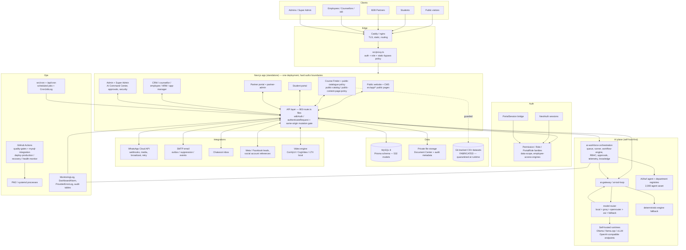

# 02 — Architecture and Integration Map

**Date:** 2026-10-12 · **Commit:** `be9081f` · Derived from live tree inventory + `docs/ALO-EDUCATION-FULL-AUDIT.md` (2026-10-01).

## 1. Deployment authority

The **authoritative application** is the root Next.js (App Router, React 19) standalone app: `npm run build` → `.next/standalone/server.js`, booted by `server.js` under PM2 (`ecosystem.config.cjs`, service `alo-education`). Two deployment topologies exist and must be reconciled in Phase 1:

- **VPS/Hostinger-style:** `deploy/ubuntu/` (Caddy + systemd `alo-education.service` + `backup.sh`/`restore.sh`/`rollback.sh`/`health-check.sh`), `nginx.conf`, `alo-vps-deploy.sh`, `deploy-build/` snapshot.
- **Docker:** `docker-compose.yml` (services `app`, `db` MySQL, `nginx` + volumes/network).

Side trees are **not** deployment authority: `alo-education-web-crm-final/` (historical export), `alo-cpanel/` (legacy PHP), `backend/` (Python AgentOS), `mini-services/` (Bun) — see audit `01` §C2.

## 2. Logical architecture

## 3. Request-path security layers (as verified)

1. **`src/proxy.ts`** — authentication, role-route gating, static-asset allow-list (K4 hardening: no "path contains a dot" bypass for `/api/**` or role-gated prefixes).
2. **Handler-level `withAuth` / `authenticateRequest`** — user-type/role checks (post-K1: verified user types, not client role claims).
3. **Object-level scoping** — `data-scope.ts`, `access-control*`, `employee-access-engine.ts`, partner tenant scoping (`auth.partnerId` server-resolved).
4. **`mutationOriginAllowed`** — same-origin gate on mutations (`src/lib/request-origin.ts`; depends on `NEXTAUTH_URL` — risk D5).
5. **Audit** — `PortalAuditLog`, `AloAuditLog`, `IntegrationAuditLog`, `CrmAuditLog`, `EmployeeAuditLog`, `AgentAuditLog`, `AwfAuditLog`.

## 4. AI plane detail (§9–§12 mapping)

| Requirement | Implementation | Notes |
|---|---|---|
| Shared orchestration | `src/lib/ai-workforce/` — `runner.ts`, `workflow-engine.ts`, `automation.ts` | shared pool design (§9: no 2,000 OS processes) |
| Task queue + ledger | `AwfRun`/`AwfRunStep`/`AwfTaskLedger`, `AgentTask`, `AiTask` | persistent; retry/dead-letter semantics need evidence pass |
| Model router | `src/lib/model-router.ts` | **local-first** (`private_data_local`, `configured_local`), then groq/openrouter/zai; deterministic `fallback` |
| Self-hosted runtimes | `src/lib/ai-workforce/runtimes.ts` (`alo-local-primary/secondary`, `local-openai` provider) | Ollama/llama.cpp/vLLM compatible |
| Provider-independent interface | `ai-gateway.ts`, `ai.ts`, `text.ts`, `output-schemas.ts` | structured-output validation exists |
| Approval gates | `ai-workforce/approvals.ts`, `AgentApprovalQueue`, `ApprovalQueueItem`, `AwfApproval`, `agentos/approval-transition.ts` | transactional transitions |
| Least-privilege tools | `ai-workforce/tools/registry.ts` + `AwfTool`/`AwfToolGrant`, `security.ts`, `rbac.ts` | adversarial proof pending (D8) |
| Knowledge layer | `ai-workforce/knowledge.ts`, `MarketingRagSource/Chunk`, `AwfKnowledgeSource/Chunk`, `KnowledgeBaseArticle/Document` | §12 query-time permission proof pending |
| Deterministic fallback | `ai-workforce/deterministic-engine.ts`, `synthetic-data-guard.ts` | fail-closed synthetic data policy (ALO_ALLOW_SYNTHETIC_AGENT_DATA non-production only) |
| Registries | see audit §C1 — six families | consolidation decision = Phase 1 |

## 5. Integrations and external dependencies

| Integration | Code | Live status | Charge class |
|---|---|---|---|
| WhatsApp Business Cloud API | `whatsapp-cloud-api.ts`, `whatsapp-webhook-handler.ts`, media ingestion, `WhatsAppRetryQueue` | NOT VERIFIED (no credentials here) | third-party messaging charges (§8/§10 note) |
| SMTP email | `.env.example` SMTP block, `EmailOutboxItem` | NOT VERIFIED | existing provider — **preserve DNS/MX/SPF/DKIM/DMARC (§15)** |
| Chatwoot | `chatwoot-inbox.ts` | NOT VERIFIED | self-host possible |
| Meta/Facebook leads + social references | `facebook-lead-sync.ts`, `SocialAccount*` | NOT VERIFIED | platform terms |
| Local video/image gen | `comfyui-client.ts`, `video-engine/ai-generation/*` (CogVideo, LTX), `runninghub-client.ts` | NOT VERIFIED | self-host compute; RunningHub is external |
| **LLM providers** | `model-router.ts`: **local** first; groq/openrouter/zai/openai configured via env keys | keys wired in env templates | **§10 policy: no paid LLM API for normal inference — enforcement gap B1** |

## 6. Data plane

- **MySQL** (compose service `db`; CI `mysql-integration` job uses MySQL 8). ORM: Prisma; `prisma/migrations` + `database/seeders`.
- **Schema size:** 532 models, 0 enums (status strings) — migration discipline required (§14).
- **Files:** Document Center models (`Document`, `DocumentVersion`, `StudentDocument`, `EmployeeDocumentVersion`, `DocumentSecurityIncident`, `FileMetadata`…); storage roots `storage/`, `public_html/`; **no signed-URL code found** (B3) — download path must be verified as an authenticated service.
- **Known data-quality state:** root CSV datasets are templated/fabricated and runtime-guarded (audit §B5/§D7); no verified catalogue import has been performed.

## 7. Operations plane

- **CI:** `.github/workflows/ci.yml` (`quality-gates`, `mysql-integration`), `deploy-production.yml`, `deploy-recovery.yml`, `health-monitor.yml`.
- **Processes:** PM2 (`ecosystem.config.cjs`), systemd unit, scheduled jobs (`src/cron`, `/api/cron`, `MonitoringJob`, `CronJobLog`).
- **Observability:** structured log tables (`MonitoringLog`, `ProviderErrorLog`, `EventLog`, `AutomationMetric`, `VerifiedMetric`), `DashboardAlarm`, admin `/admin/ai-monitor`, `/admin/sla-monitor`, `/admin/audit-logs`.
- **Release discipline to enforce (Phase 6):** Git-based promotion → staging verification → backup → production → health check → rollback plan (`ROLLBACK-GUIDE.md`, `deploy/ubuntu/rollback.sh`).
