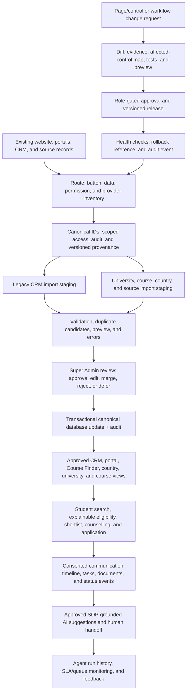

# ALO Education Web + CRM — End-to-End Workflow Plan (Draft)

**Status:** planning draft; not an implementation, migration approval, launch approval, or production-readiness statement.

**Approach:** extend the existing ALO Education website, CRM, portals, Prisma/MySQL schema, dashboards, and integrations. Do not replace them with a demo or parallel application.

**Release rule:** no public facts, external messages, imports, approvals, migrations, or deployments are reported as successful without observable evidence.

## 1. Outcomes and operating principles

1. One connected student journey: inquiry → consent → lead/profile → counselling → course shortlist → documents → application → offer → payments → visa work → decision → enrolment.
2. One canonical record and identity for each student, partner, employee, lead, application, conversation, document, task, appointment, and audit event; retain legacy IDs as aliases/source IDs.
3. One authoritative, versioned source for each public university/course fact. Public search defaults to approved, current, international-student-eligible records; uncertain facts remain staged or visibly marked for review.
4. All writes are authenticated, server-authorized, scoped, validated, idempotent where possible, transactionally persisted, and audited. Client-side visibility is not authorization.
5. AI proposes and explains; it does not invent requirements, prices, deadlines, rankings, immigration rules, successful delivery, or approvals. Human approval gates publishing, merges, sensitive messaging, and material data changes.
6. Reuse actual routes and data models where sound. Before adding a model or service, map the existing schema and identify whether a safe extension or a migration is required.
7. A passing unit test is not proof of a database, provider, browser, CI, or production integration.

## 1.1 Governing correction: reconcile, not rebuild

The first operation is **RECONCILE, NOT REBUILD**. Use this strict sequence for every workstream: **discover → classify → reuse → extend → merge → verify**. The repository already contains substantial AI Workforce, agent/SOP/knowledge, university monitoring/import, CRM, portal, communications, dashboard, and security code. Those are evidence of implementation surfaces—not proof that they are complete, secure, integrated, or production-operational.

- Do not add another agent registry, SOP database/search stack, command center, university/course catalog, CRM/import center, dashboard, workflow engine, permission system, integration layer, or migration family until every existing candidate is mapped to its models, routes, callers, data, tests, ownership, and live status.
- Mark each existing item as `ACTIVE CANDIDATE`, `LEGACY IN USE`, `OVERLAP`, `UNUSED/UNVERIFIED`, `BLOCKED`, or `RETIRED` only when repository and data evidence justify that label. A path name, schema model, seed record, passing mock, or UI label alone is not runtime evidence.
- Reuse the soundest existing implementation. Extend it additively where possible. Preserve IDs, source lineage, history, permissions, and valid pending working-tree changes. Reconcile duplicate records and references before merging; never merge orphan branches or model families wholesale.
- Do not create or alter Prisma models/migrations until the schema/model/API/data-reference map identifies a genuine gap and a safe migration path. Never use production credentials or destructive schema commands.
- Keep the website/system inventory authoritative in the database and machine-readable. Markdown, generated reports, and test fixtures are evidence or exports—not substitutes for the required database-backed registry.

## 1.2 End-to-end operating flow

The recurring control loop is **detect → classify → assess impact → request approval → change → test → stage → deploy only when authorized → smoke test → record evidence**. Run it daily for health/data drift and on every proposed change; failed gates pause the sequence and create a human-owned remediation item. Readiness is calculated from evidence-backed control states and a timestamped denominator; `BLOCKED`, `NOT VERIFIED`, or `FAIL` on any critical gate forces an overall `NOT READY` verdict regardless of the numeric score.

## 2. Mandatory master execution order (phases 0–18)

This is the release sequence. The detailed design sections below elaborate its work; they do not permit skipping ahead or creating a parallel subsystem. Phases 0–4 are reconciliation and safety gates: no feature/model expansion starts before they are complete. Production phases require explicit authorization, backup evidence, and the gates below.

| Phase | Ordered work | Exit evidence / stop condition |
|---:|---|---|
| 0 | Reconcile Git, repository, branch, base, all tracked/untracked changes, commits, PRs, CI, migration history, and deployment config. Preserve and classify the current working tree; operate only on `arena/44842eb6-alo-education-z-ai`. | Reproducible Git/change ledger, branch/HEAD recorded, every change grouped and dispositioned; no push to `main`. |
| 1 | Inventory existing pages/routes, API handlers, forms/buttons, schemas/migrations, agents/SOPs/knowledge, CRM, university/course/code data, imports, dashboards, providers, tests, and deployment paths. | Machine-readable discovery artifacts and source-of-truth/caller maps; unknowns explicitly `UNKNOWN`/`NOT VERIFIED`. |
| 2 | Classify existing implementations and data as active candidate, legacy in use, overlap, unused/unverified, blocked, or retired; resolve semantic duplicates and ownership before selecting canonical sources. | Per-workstream reuse/extend/merge/retire decision with references, current data counts where safely available, and reversible reconciliation plan. No duplicate subsystem. |
| 3 | Reconcile identity, authentication, tenant/object/department/branch scope, RBAC, consent, privacy, audit, and approval boundaries. | Server-side permission matrix plus allow/deny/object-scope tests; fail closed where actor/resource scope is unknown. |
| 4 | Reconcile the actual Prisma/MySQL schema, current production/staging migration state where authorized, model aliases, foreign keys, data lineage, and rollback/backup path. | Canonical model map and additive migration plan only for proven gaps; otherwise extend existing models. If client/database proof is unavailable, record `BLOCKED` and do not claim readiness. |
| 5 | Reconcile the existing AI Workforce, agents, departments, skills, tools, workflows, models, memory, knowledge, SOPs, approvals, and telemetry. | One governed runtime/registry decision, applicable SOP/knowledge/version/RBAC preflight, audited run path, tested real outcomes; no second workforce. |
| 6 | Reconcile website route/page/control identities and create or extend the **database-backed** page/element registry and verified page/link/API/data-impact graph. | Stable machine-readable IDs for pages and controls, owners/roles, route/API/data effects, verification state, evidence, and change dependencies. |
| 7 | Verify every public and authenticated link, button, tab, menu, form, upload, CTA, API, permission, audit event, and user-visible result end to end. | Evidence-backed PASS/PARTIAL/BLOCKED/FAIL per control; no toast-only success, unresolved internal full reload, dead link, or false submission/delivery claim. |
| 8 | Reconcile university/course/country and jurisdiction-specific international-student code catalogs, official-source provenance, verification/currentness, duplicates, statuses, and history. | Provenance-backed current/historical/active/expired/unknown records; unsupported or ambiguous codes marked `UNKNOWN`/`NEEDS_VERIFICATION`; no fabricated coverage. |
| 9 | Reconcile CRM identities, leads/students/partners/applications/conversations/tasks/documents, old-CRM import staging, dedupe, approval, rollback, and audit. | Idempotent staging/preview/approval/import and cross-record ownership tests on disposable data; production records remain untouched without backup/reconciliation. |
| 10 | Connect verified website, CRM, employee/student/partner portals, university/course records, forms, document/file generation, communications, and workflow APIs using existing integrations. | Real persistence and provider evidence per integration; unavailable authorization/provider is clearly surfaced, never mocked as success. |
| 11 | Reconcile role-scoped employee, counselor, partner, student, CRM, and Super Admin dashboards over their authorized data. | Each metric has an identified source, scope, timestamp, empty/unavailable state, and permission test; no invented feed or aggregate. |
| 12 | Consolidate existing Super Admin, AI, CRM, and access-control surfaces into one governed Command Center, with inventory, impact preview, approvals, Git diff, test/staging/deploy gates, rollback, and audit. | One existing surface is selected/extended; high-impact changes cannot bypass approval or audit; no arbitrary code/SQL execution. |
| 13 | Validate design tokens, responsive behavior, accessibility/contrast/keyboard/ARIA, hidden text, page metadata, SEO, sitemap/robots, and content accuracy. | Automated and manual evidence tied to page/control IDs; visual change approved and no SEO/accessibility regressions. |
| 14 | Run unit/API, disposable-MySQL integration, migration/drift, security, browser/E2E, build, lint, typecheck, and CI verification. | Named logs/results and known limitations; skips are `NOT RUN`, not PASS; no test deletion, fake DB URL, or hidden suite failure. |
| 15 | Prepare a release candidate: clean reviewed diff, secret scan, backup/restore rehearsal, migration dry run, rollback procedure, deployment SHA, and staging smoke evidence. | Signed-off candidate and recoverability evidence. If Hostinger/DB/provider access is absent, stop with `BLOCKED`. |
| 16 | Deploy to Hostinger/`https://aloeducation.com` only via the verified, approved release mechanism, after backup and migration review. | Actual deployment/run identifier, artifact SHA, migration result, health evidence, and audit trail; a Git push is not a deployment. |
| 17 | Run post-deployment public and authenticated smoke tests: core routes/forms/data writes, RBAC/object scope, files, integrations/webhooks, queues/cron, logs, and rollback trigger. | Timestamped results and request IDs from the real target; failed critical gate means rollback/hold, not acceptance. |
| 18 | Publish an evidence-based completion report with per-requirement PASS/PARTIAL/NOT VERIFIED/BLOCKED/FAIL, exact evidence/paths, remaining risks, and production verdict. | No unsupported success/readiness statement. Production readiness is `NOT READY` until every critical security, data, migration, runtime, integration, CI, and smoke gate is evidenced. |

## 3. Phase 0 — repository, product, and deployment inventory

**Deliverables:** route/control inventory, schema/provenance map, baseline test report, Git change ledger, database-backed registry decision, and a verified deployment diagram.

### Preliminary reconciliation evidence (not a readiness claim)

Repository inspection confirms overlapping implementations that must be mapped before any new registry, model, or dashboard is proposed:

| Area | Existing repository anchors found | Reconciliation status |
|---|---|---|
| AI Workforce | `src/lib/ai-workforce/` includes a runner, workflow engine, role checks, versioned knowledge ingestion/retrieval, memory, approvals, tools, audit, and telemetry; `/api/ai-workforce/*`, `/super-admin/ai-workforce`, and `/admin/ai-command-center` exist. | **Substantial implementation candidate; not production-verified.** Do not add another workforce/runner/dashboard. |
| Agent/SOP overlap | Prisma contains `AwfAgent`/`AwfWorkflow`/`AwfRun` and related AWF records alongside `AiAgent`, `AiAgentRegistry`, `AiEmployee`, `AgentDefinition`/`AgentTask`, and `AiSop`; source/API handlers still use multiple families. | **Overlap in active code.** Compare record counts, callers, permissions, seeds, and history before naming one canonical registry or migrating/retiring another. |
| SOP/knowledge semantics | `AwfKnowledgeSource`/`AwfKnowledgeChunk`, `EmployeeLearningResource`, `KnowledgeDocument`, and `KnowledgeBaseArticle` coexist. Student Statement-of-Purpose records include `SopDraft` and `AloSop`; `AiSop` is a separate model. | **Do not conflate student Statements of Purpose with employee/agent Standard Operating Procedures.** There is no verified unified SOP catalogue/search yet. |
| University/course | Existing `/universities` directory and `/universities/[slug]` info page, Course Finder, `CrmUniversity`/`CrmCourse`/`CrmCourseIntakeFee`/`CourseIntake` models, research/source-evidence and monitoring models, admin pages, imports, and scheduled scans exist. Local working-tree changes add server-paginated directory results, public active/verified/published filters, a detail-API January 2027–January 2028 inclusive intake query with course pagination, and UI rendering of matching intake rows, code/source/eligibility/verification fields, and field-presence counts; static intake defaults were removed. `universityCode`/`courseCode` remain ungoverned strings, not an international-code catalogue. | **Existing-surface extension candidate; capability partially implemented, completeness NOT VERIFIED.** No authorized database/export coverage query, browser verification, or full source/monitoring reconciliation has been performed. Official source verification, applicability/active status, and live data/cron remain unverified. |
| Website controls | The app has `src/app/sitemap.ts` and `robots.ts`; an initial schema/source search did not identify a dedicated database-backed page/element/control registry. | **Registry gap not yet confirmed across every migration/runtime path.** Sitemap is not a button/form/API-impact inventory; complete discovery before an additive model is considered. |
| Employee knowledge surfaces | Employee-learning and knowledge-center APIs/pages exist in addition to AWF knowledge retrieval. | **Security and semantic reconciliation required.** The employee-learning list accepts caller-supplied department/role filters and its current filter composition uses OR; do not treat that as proof of scoped employee SOP search. |

- **University page-copy caveat:** `UniversityHub` still contains generic, university-independent claims and examples (including English thresholds, scholarships, student-choice/work-rights, deposits, document lists, September deadlines, accommodation/career/student-life text). They have not been source-verified per destination or provider and must be reviewed under phase 13 before the page can be described as complete or fully accurate.
- **New platform/source-request caveat:** the committed baseline is Next.js 16/React 19/Node.js 22 with Prisma/MySQL; the tracked Hostinger deployment guide explicitly describes Node.js hosting and says PHP/static cPanel fallback is not authorized. The new PHP-only/cPanel instruction conflicts with that architecture and the reuse-first phase gates, so no stack rewrite or deployment has started. Four supplied `engralaminn-collab` GitHub repositories returned HTTP 403 to the current Arena GitHub integration; inspect them only after GitHub access is reconnected. The other supplied live websites were not independently verified in this environment.

Defects found during reconciliation are included in the control inventory. The following safety fixes were made in the existing surfaces this turn; they do not establish full integration or production operation:

- `UnifiedEmployeeDashboard` previously reported AI follow-up/SOP generation success from toast callbacks without an API request. Those controls are now visibly disabled as unavailable and the copy says no draft/SOP is generated. A governed, role/department-scoped workflow is still required before re-enabling them.
- `/admin/ai-command-center` previously displayed hard-coded “connected”/`RUNTIME ACTIVE` status and keyword-mapped free-text dispatch. The unverified status claims and dispatcher are now removed/disabled; counts are labeled as a legacy AgentOS database snapshot. `/api/automation/run` now rejects unscoped lead workflows and returns failure/unverified states without treating them as success. Seven focused route-safety tests pass, including validation of follow-up timing bounds; real database/workflow behavior remains unverified.
- `/api/ai/sop` is a separate Statement-of-Purpose generator, not an employee Standard-Operating-Procedure search contract; it lacks the shared AWF guard in the inspected route. Do not reuse it for internal SOP access before security and semantics are reconciled.
- AWF knowledge retrieval has a role allow-list and filters sources before ranking, but the current inspected retrieval does not enforce source-department scope; `ActorContext.departmentSlug` is populated from auth `branch` context. Department-level employee access is therefore **not verified**.
- The broad employee-learning/knowledge-center routes have not been proven to honor employee-object, department, or publication scope end to end. Reconcile/fix their existing contracts rather than adding a competing search endpoint.

**Latest local verification (not a readiness claim):** branch `arena/44842eb6-alo-education-z-ai`, HEAD `59528db2b9fc62ab02d6a963fd99b8a7e37ef2f3`, 155 `git status --short` entries, no commit/push; the complete per-path phase-0 change ledger is still outstanding. Full `npm run lint` passed before the final narrow university edits; targeted ESLint over all affected university files/tests and current `git diff --check` **PASS**. Focused university intake/directory tests: 3 files, 17/17 pass. The previously recorded focused automation-route safety tests (7) and a four-file automation/employee-scope/email run (37/37) also passed. The latest full Vitest run, after `npm ci --ignore-scripts --no-audit --no-fund`, had 852 tests pass and 28 skip, while 5 test files failed during import because the generated `.prisma/client/default` module was absent; those suites are **NOT VERIFIED**, not passing. An earlier full-run snapshot recorded 880 pass, 14 fail, and 35 skipped; it is superseded by the latest environment-specific result, not evidence of a clean suite. Typecheck remains **BLOCKED** at the Prisma-client verification gate; build was previously **BLOCKED** before Next build by TLS failure fetching Prisma's schema engine. No authorized university database/export query or browser coverage audit was performed; Jan 2027–Jan 2028 record coverage and all-active-code coverage remain **UNKNOWN/NOT VERIFIED**. Disposable MySQL, production database, Hostinger, provider authorization, live browser, and deployment behavior are **NOT VERIFIED**.

- Record the current branch, HEAD, working-tree changes, tracked/untracked files, migration history, recent CI runs, and deployment configuration. Work only on the Arena branch; never push this work to `main`.
- Inventory every App Router page, API route, server action, middleware/guard, layout, portal, dashboard, database model, migration, import, cron, provider adapter, storage backend, and test.
- Crawl UI source and the running app (when runnable) for every `Link`, `href`, `router.push/replace`, button, form submit, tab, menu item, floating action, modal, keyboard action, and disabled/no-op control. Give each page and control a stable machine-readable ID in the database-backed registry, with parent/child and impact relationships. Record source component, visible/accessibility label, route/API target, role/object scope, data source and mutation, success/error state, audit event, test, last evidence, and verification status. A Markdown route list or generated sitemap is not the canonical registry.
- Inspect desktop/mobile navigation, collapsed menus, tooltips, accessible names, metadata, `aria-*`, CSS pseudo-elements, hidden/header text, fallback text, and theme tokens. Reconcile the requested orange `#E8501A`, white background, and professional blue accent with the currently approved ALO brand tokens before globally replacing colors. Do not silently recolor unrelated product areas.
- Identify all public facts and existing university/course/country records with provenance, publication state, international-student eligibility, freshness, duplicates, and field completeness. Produce counts from the actual database or a safe export; never infer production counts from seed files.
- Map current environment, Node/runtime, Hostinger/cPanel package, health routes, CI databases, backups, rollback path, and provider credentials by *presence/status only*. Never print secrets or use production database credentials in a test.

**Exit gate:** no implementation milestone starts until the inventory explains the existing source of truth and the exact surfaces being modified.

## 4. Phase 1 — shared identity, permissions, audit, and workflow foundations

### 4.1 Canonical identity and safe cross-linking

- Reconcile current student, employee, partner, lead, application, and conversation IDs before adding generators. Enforce uniqueness at the database layer and use transactions/atomic sequence allocation for IDs such as `AE-YYYY000001` and the approved employee format. Keep legacy CRM ID, previous employee ID, and external provider IDs as immutable aliases/source keys.
- Resolve the requested employee-ID conflict (`ALO-EMP-YYYY0001`) against existing employee codes during the inventory; preserve old IDs and avoid rewriting foreign keys in place.
- Add explicit relationships or validated link tables where current fields are free-text IDs. Validate ownership/scope on every read and write. A message or upload without a verified parent remains quarantined, not orphaned or auto-attached by guess.

### 4.2 Authorization and employee/partner access

- Build a centralized server-side access service from authenticated identity, active account state, designation/role, permission package, feature rules, branch/country/partner scope, and resource ownership. Define deny-by-default behavior and test 401, 403, and authorized responses.
- Employee personal, salary, bank, NID/passport, emergency-contact, leave, and HR-document data have separate permissions. Audit each authorized sensitive view/download/change. Never expose these through general dashboard metrics.
- Super Admin creates/activates employees through a hashed, expiring, single-use activation link; password must be set before login. HR review states and corrections are explicit. Activation mail is sent only through a configured provider and is logged; a queued email is not reported as delivered.
- Partner packages and assignments are data-driven: seats, image/video quotas, video-duration caps, student benefits, vouchers, and approval flags. Every quota check is server-side and recorded; over-limit actions fail safely. Partner managers can manage only their own company.
- Create append-only audit records with actor/effective actor, role, session, action, target, scope, timestamp, request correlation ID, before/after summaries, outcome, and source. Minimize PII in audit payloads.

### 4.3 Employee SOP and AI-agent knowledge — reconcile existing systems first

- Reconcile existing `AwfKnowledgeSource`/`AwfKnowledgeChunk`, `AiSop`, `EmployeeLearningResource`, `KnowledgeDocument`, and `KnowledgeBaseArticle` data, APIs, UI callers, approvals, and version/history before changing schemas or building search. Keep student Statement-of-Purpose workflows (`SopDraft`, `AloSop`, and their routes) separate from internal Standard Operating Procedures.
- The current AWF knowledge service already provides versioned chunk ingestion, citation/freshness metadata, role-allow-list filtering before retrieval scoring, and audit. Reuse it if review confirms it is the correct governed source; do not create a second RAG/index. Before employee exposure, verify server-side department/branch, confidentiality, object scope, approval/published state, freshness, and source links. The currently inspected AWF search checks role but does not establish department-scope enforcement; mark that gate `NOT VERIFIED` until fixed and tested.
- Add or enable employee SOP search only after a secure canonical source and ACL contract are selected. Use authenticated identity and server-side role/department scope—not caller-supplied filters or request-body roles. Return only available source title, source/version, citation/section, verification/freshness date, and an authorized original-source link. If no approved source matches, say so and offer human escalation. Do not invent policy or show illustrative/example results as real.
- Require each governed SOP record to retain owner, department/role scope, effective date, revision, approval/published state, source file/URL/hash, confidentiality, and review/expiry state. If a required field is absent from the selected existing model, record the gap and design a minimal additive extension only after phase 4 proves no usable existing field/model.
- Load applicable, current, approved SOP/knowledge and memory under the authenticated actor's permissions before an agent runs. Agent execution is denied/escalated if required SOPs, source freshness, role scope, or required provider/tool permission cannot be verified.
- Reuse the existing AWF runner and `AwfRun`/`AwfRunStep`/`AwfToolCall`/`AwfApproval`/`AwfAuditLog` telemetry where safe. Record agent/version, trigger, input references (not secrets), SOP/data source IDs and versions, tool calls, approvals, output hash, duration, runtime/provider/model when available, result, errors, and human overrides. Redact student PII from routine telemetry; never add duplicate run/audit tables until actual capability gaps are proven.

## 5. Phase 2 — data centres and controlled imports

### 5.1 Old CRM Student Migration Import Center

**Flow:** upload → parse → map → validate → stage → deduplicate → preview → approve → transactional import/merge → reconcile → audit/report.

- Accept CSV/XLSX only after file-type/size checks, malware scanning where available, spreadsheet-formula neutralization, encoding/column checks, and tenant/role checks.
- Stage every row first. Preserve the source CRM, source CRM ID, original row number, raw source snapshot/hash, mapped values, consent evidence, and import batch. Do not write directly into live students during preview.
- Normalize phone/WhatsApp/email/passport/legacy IDs; generate match candidates from exact identifiers first, then explainable fuzzy name/date/context signals. A fuzzy name match is a duplicate *risk*, never automatic identity proof.
- Preview new profiles, exact matches, merge suggestions, conflicting values, duplicate risks, missing required fields, invalid fields, linked records, and errors. Existing data is not overwritten without Super Admin approval and a recorded field-level before/after decision.
- Approve each batch and each material merge. Apply idempotently in a transaction; generate a student ID only for a confirmed new record. Link notes, communications, applications, documents, payments, visa status, tasks, and dates to the same canonical student ID, retaining original history/source IDs.
- Imported documents go through secure storage and metadata validation. Do not create public URLs. Portal/login links are optional, separate approvals; no SMS/WhatsApp is sent before explicit Super Admin approval and consent checks.
- Persist batch, staging rows, errors, duplicate candidates, decisions, applied-record references, audit events, and a downloadable reconciliation report. Provide rollback/compensation procedures that preserve audit history.

### 5.2 University and course data centre — reuse existing catalog and monitoring surfaces

- First reconcile the existing `/admin/university-data`, `/admin/university-data-updates`, course/import-center pages, `/api/university-monitoring/*`, `/api/admin/university-data/*`, course/university import routes, scheduled scans, and current `CountryPage`/`UniversityPage`/`CoursePage`/research-evidence/update-request models. Do not create a second catalog, scraper, import center, or monitoring dashboard.
- Extend the existing university/course/country/course-finder/CRM models where viable. Avoid a second catalog. Normalize universities, campuses, courses, intakes, fees, requirements, scholarships, rankings, source evidence, verification history, change requests, approvals, and publication state.
- Each fact carries source name/URL/type, official-source flag, collected and verified timestamps, reviewer, evidence/hash, data version, review notes, and status. Keep history rather than overwriting approved values.
- Treat international-student codes as separately governed, jurisdiction-specific source catalogs. Define code system, jurisdiction, applicability, effective interval, status (`CURRENT`, `HISTORICAL`, `ACTIVE`, `EXPIRED`, `UNKNOWN`/`NEEDS_VERIFICATION`), official source, citation, retrieval/verification timestamp, and reviewer. Do not infer that two similarly named code systems are interchangeable or claim “all active codes” until scope and coverage are evidenced.
- Build CSV/XLSX templates and a staged importer. Import order: countries → universities → courses → intakes/fees → requirements → rankings → source verification. Use stable external IDs and idempotent upserts. Identical values are skipped; harmless normalization is reviewed by deterministic rules; material differences become approval requests; suspected duplicates are blocked for human review.
- Match universities by normalized official name/domain/country and courses by university, normalized title, qualification/level, campus, and official URL. Similarity suggests; it does not silently merge. Super Admin can compare and merge while preserving aliases/history.
- Publish by explicit state: only approved records with an official source and verified international availability appear in default public search. Closed, discontinued, domestic-only, stale, unsupported, duplicate, or uncertain records are quarantined or clearly archived, not deleted.
- Weekly verification agent is read-only against explicitly approved official public URLs; obey robots/terms/rate limits, use allowed provider feeds, and stop on access controls/CAPTCHA. It records evidence and diffs into `update_requests`; it never publishes automatically. Super Admin can edit, approve, reject, merge, defer, or schedule recheck.
- Add the requested upcoming intake window **January 2027 through January 2028 inclusive** to existing university information pages: every supported university and every active course offering with a matching intake must be reachable through server pagination (not “popular”/top-N truncation). Show each intake date/status, the recorded institution/course code, international-student eligibility, source, verification state, and freshness. Do not fill gaps with static month defaults or seed filler. Current data coverage for this window is **UNKNOWN** until measured from an authorized database/export.
- A local working-tree candidate now supplies this capability through the existing directory/detail APIs and UI, including page controls and field-presence counts; focused mocked route/helper tests pass. This is not evidence that every applicable university/course/intake is in the database, that a source is official/current, or that all users can reach every page. Keep the change as a candidate while phases 0–4 remain incomplete; do not bypass the strict master sequence.
- Historical coverage from January 2008 through January 2027 is represented only when source evidence exists; distinguish historical from current/upcoming records. Do not fabricate future intakes or historical fees. Existing `CrmUniversity.universityCode` and `CrmCourse.courseCode` are unstructured default-empty strings and do not prove code authority, active status, international applicability, or completeness. Enumerate the official catalogs/jurisdictions (qualification, provider, course, visa/classification codes, as applicable) before claiming “all active codes”; the missing catalog/status/effective-date/provenance contract must be resolved before adding a second code registry.

### 5.3 Data status and coverage reports

- Generate university/course/country inventory reports from real records: published, verified, pending, stale, rejected, missing-source, international-status unknown, duplicates, countries, course levels, research routes, intakes, ranking providers/editions, and dates.
- Treat 140 UK institutions and 20 per other supported destination as *coverage floors*, not filler targets. A country exception needs evidence. No invented university, fee, rank, intake, visa rule, scholarship, requirement, supervisor, research funding, or admission outcome.

## 6. Phase 3 — catalog, course finder, eligibility, and public pages

- Public routes remain actual routes in the existing Next app: Course Finder, university directory/detail, course detail, country/destination pages, scholarships, research opportunities, comparison, eligibility, and application guidance. Inspect current routes first; do not create route aliases or a second homepage as a substitute.
- On each existing university information page, expose every approved, current course offering with an intake from **January 2027 through January 2028 inclusive** using server-side pagination; include all qualifying course records, not only top 8/20/popular entries. Display its recorded course/institution codes, exact intake, active/closed status, international-student eligibility, official source, verification state, and last-checked date. Show counts and explicit missing/unverified-code/eligibility coverage; do not claim completeness from an empty page or partial API response.
- Search uses server pagination, indexed filters that exist in the database, limits, debouncing, cache rules, and responsive empty/loading/error states. Hide filters with no real values. Default to approved, current, international-open records; show verification/freshness/source context.
- University/course details display only available verified values. Missing facts say “Not published,” “Verification pending,” or “Ask an ALO counsellor.” Rankings always identify provider and edition; unranked is not presented as low quality.
- Profile-based matching uses versioned structured rules and returns explainable states: eligible, likely eligible, conditional, partially matched, not currently eligible, insufficient information, or counsellor review. Each rule result compares the official requirement with the student value, source, and verification date; every fail shows alternatives/improvement actions. AI may explain verified rule results but cannot override them.
- Eligibility snapshots preserve student-profile version, course-data version, rule version, source timestamps, reason codes, and counsellor override/reason. A changed course or profile creates a new assessment; old assessments remain auditable.
- Apply flow checks login/consent, prevents duplicate applications, saves course/university interest, creates/updates CRM lead/profile, attaches eligibility and document checklist, assigns counsellor, creates task/notification, records timeline/audit, and shows a truthful next step. A draft or queue is not described as a submitted university application.
- Country and university pages are driven by database-backed approved content. FAQs, “why study,” living costs, work rights, visa notes, and timelines require sources and clear freshness; the AI cannot invent or guarantee outcomes.
- Compare/save/share/download features require authorization and scope; PDF/data export is audited and does not disclose restricted B2B/commission details.

## 7. Phase 4 — communications, WhatsApp AI, marketing, and contact CTAs

### 7.1 Public communication actions

- Add exactly three visible, responsive branded actions in approved conversion locations: website AI chat, WhatsApp AI Agent using the supplied local number `01805020100`, and official ALO Facebook page/inbox. Resolve the real AI-chat route and Facebook URL from the existing project/verified company configuration; never invent the Facebook destination. Convert/format the WhatsApp link only after validating the configured number. Avoid duplicates/overlap with login/navigation/forms.
- Track click analytics with privacy-conscious events. Click/open is not a sent message or delivered lead.

### 7.2 Unified communication and after-hours AI

- Use official WhatsApp Cloud API/Meta APIs and approved email/SMS adapters only. Keep provider account ownership, page assignments, tokens, webhook verification, opt-in, block/unsubscribe/STOP, and platform rate limits in protected server configuration.
- Every inbound/outbound message, comment, DM, call note, upload, task, appointment, AI draft, human reply, and status change links to its real channel/message/conversation and the applicable lead/student/partner/application/employee IDs. Store provider delivery receipts separately from request acceptance.
- During Bangladesh business hours (10:00–18:00), employees own responses; AI can draft. Outside hours, the AI may send approved safe first responses and answer general questions from approved, current SOP/catalog content. It identifies as the ALO Education AI assistant, uses Bangla/English as appropriate, offers human callback, and never impersonates an employee.
- Student identification by phone is a matching hint, not access proof. OTP/portal authentication is required before private application, document, payment, visa, or personal data is revealed. Unknown numbers may create a *lead* only after required consent and idempotent duplicate checking; student profiles/IDs/tasks/login links follow separately approved rules, not a false “student registered” claim.
- Sensitive, uncertain, angry, complaint, refusal, payment, emergency, or high-impact cases hand off to a human, create a scoped task, notify the assigned team, and preserve the same communication timeline. Document uploads remain quarantined until sender, profile, type, storage, malware scan, and parent linkage are verified.
- **SLA configuration blocker:** the supplied rules combine a 40-minute first-response SLA with a manager escalation after 20 minutes and a further Super Admin escalation after 10 minutes. Encode the thresholds as configurable, record the actual elapsed-time policy, and do not enable production escalation until the escalation order, business-hour clock, pause rules, and recipient roles are approved.

### 7.3 Marketing control plane

- Marketing Manager owns official company channels; Super Admin has oversight. Three approved marketers receive only explicitly assigned draft permissions. All other employees can use only their own authorized communications and assigned threads.
- Provide inboxes, campaign calendar, approved brand assets, content/image/video drafts, comments/keywords/auto-DM rules, lead pipeline, assignment, consent/unsubscribe, human handoff, analytics, and audit. Drafts need approval before a provider call; live posting requires returned provider evidence. Do not count AI-generated posts as published.
- Brand asset manager records logo source/version and brand tokens; if no approved logo exists, content generation is blocked or saved as an unbranded draft per policy.
- n8n/webhooks can trigger approved workflows, but credentials remain server-side; workflows have explicit On/Off, dry-run, replay/idempotency, retry/dead-letter, and approval controls.

## 8. Phase 5 — central command center and website-wide change control

- Reconcile the existing `/admin/ai-command-center`, `/super-admin/ai-workforce`, access-control center, master Super Admin surfaces, and CRM command-center APIs. Select and extend one role-gated Super Admin command center over the database-backed inventory; do not create another dashboard or unrestricted production shell. The inspected AI command center's “connected/runtime-active” labels and free-text keyword dispatch are not evidence and must remain removed/disabled until the shared registry, safe action schema, permissions, and execution-result contract are verified.
- Index stable page/control identities, route/API/data effects, permissions, design tokens, content/data sources, agent/SOP versions, owners, and verification evidence.
- A proposed change (copy, route target, design token, content item, course fact, permission, workflow, or agent SOP) is a versioned change request with scope, before/after diff, evidence, affected pages/buttons, automated tests, preview URL/screenshots, reviewer, approval, and rollback reference.
- Publish only approved safe changes through existing deployment/content paths. High-impact actions (public data, auth/RBAC, document security, finance, mass messaging, external posting, schema changes) require stronger approval and additional validation. No arbitrary generated code or SQL executes from chat/AI input.
- Command center status views report observed agent runs, integration state, failed jobs, queue depth, stale data, import batches, pending approvals, and audit events. “Connected/configured” is distinct from “tested,” “authorized,” “delivered,” or “live.”
- Derive the readiness score from persisted control IDs, evidence, timestamps, and criticality—not manual optimism or invented dashboard values. Show the denominator, blocked/not-verified items, evidence freshness, and critical-gate override beside the score; never display an aggregate score as launch approval.

## 9. Phase 6 — quality, security, and release gates

### Required automated checks

- Prisma schema/client generation/validation against the actual locked toolchain; migration order and drift checks; isolated disposable MySQL integration suite; data-integrity/duplicate/ID tests.
- Unit/API tests for server RBAC and object scope, deactivated account denial, import parsing/deduplication/approval/rollback, student ID concurrency, source provenance, stale-data rules, eligibility explanations, CRM persistence/idempotency, document authorization, consent/STOP, rate limits, SLA timers, and approval workflows.
- Playwright desktop/mobile flows for Student, Partner, Employee, Counsellor, CRM/Admin, Super Admin; every route/button/link/form; login/register/logout; search/filter/detail/compare/apply; SOP search; import preview/approval; contact actions; keyboard/focus/contrast/ARIA. Capture browser console/network failures.
- Provider sandbox tests use provider-approved test accounts only. Production provider tokens and data are not substitutes for unit tests.
- Build, lint, full test suite, integration test run against disposable MySQL, CI run, clean extraction/start, health checks, and rollback rehearsal. Skips are reported as `NOT RUN`, not `PASS`.

### Release gates

1. **Local:** lint/typecheck/build and isolated unit tests pass; critical route contracts reviewed.
2. **CI/staging:** disposable DB migration/seed, security/API/E2E tests, provider sandbox, browser console, data-quality report, backup and rollback rehearsal pass.
3. **Production candidate:** authorized DB/Hostinger access, verified backup and schema diff, staged migration, deployment SHA, health and public/authenticated route smoke tests, approved real data counts, and provider verification are recorded.
4. **Production-ready:** every critical gate in auth/RBAC, database/migrations, document authorization/storage, communications/webhook security, runtime, CI, and actual smoke tests has evidence. Otherwise verdict is `NOT READY` or `BLOCKED` with exact missing proof.

No production migration uses `migrate reset`, `db push` as a shortcut, destructive SQL, migration-history deletion, or production data imported before backup/reconciliation.

## 10. Git and change management

- Preserve the existing working tree; inspect `git status`/diff before each milestone and classify changes as prior valid work, required repair, generated artifact, or unrelated.
- Keep templates, SOP source files, migration scripts, tests, and reports under version control; never commit `.env`, provider tokens, imported PII, production dumps, generated archives, or unreviewed data exports.
- Use focused commits on `arena/44842eb6-alo-education-z-ai` only. Record tests and schema/provenance assumptions in the commit/report. Review diff and SHA before any handoff. Do not merge orphan branches wholesale or push/deploy to `main` from this session.

## 11. Open decisions and blockers to record, not guess

- Exact production database/Hostinger access, release method, backup custody, and runtime process are not demonstrated by this draft.
- Facebook Page/inbox URL, Meta app/page authorization, WhatsApp Cloud API phone-number/quality status, approved provider account, templates, and webhook secret are external verification items.
- Email/SMS providers and delivery callbacks are not assumed connected.
- Confirm whether requested employee IDs should migrate to `ALO-EMP-YYYY0001` or retain a current canonical format with the new value as alias.
- Define the authoritative jurisdiction-specific meaning and source catalogs for “all active codes applicable to international students”: confirm target destination countries and which code families count (e.g., institution/provider, course/program, qualification/classification, admission/visa), then identify each official register/feed and its active/effective-date semantics. `universityCode`/`courseCode` alone cannot satisfy this requirement.
- Approve the conflict between 40/20/10-minute SLA statements before activating schedules.
- Confirm consent/legal basis and retention periods for historical CRM imports, document uploads, communications, and AI processing.
- Validate any user-supplied fee, scholarship, medical/TB address, visa, work-rights, and university examples against current official sources before presenting as advice or production data.

## 12. Acceptance matrix (evidence required for each row)

| Area | Minimum evidence | Status now |
|---|---|---|
| Current Git changes | Branch/HEAD and 155-entry (`git status --short`) classification ledger; reviewed per-path diff and disposition | IN PROGRESS; 155 entries not yet dispositioned; uncommitted, no commit/push |
| Full page/link/button/hidden-copy inventory | Database-backed page/control registry, impact graph, browser crawl, all role/viewport evidence | NOT VERIFIED |
| Database-backed website/system inventory | Existing schema/data reconciliation; registry endpoint and persistence tests | NOT IDENTIFIED in initial schema/source search; NOT VERIFIED |
| Existing AI Workforce | Canonical registry/runtime decision, data/reference reconciliation, permissions, run/audit and workflow tests | PARTIAL; substantial AWF code exists, overlapping families and production operation unverified |
| Employee SOP search | Approved source/version, role + department/object ACL, source link, search audit, authorized/denied tests | NOT VERIFIED; existing knowledge/learning surfaces exist, scope/governance gap remains |
| Student Statement-of-Purpose workflow | Student ownership, authenticated generation/review/version path and audit | NOT VERIFIED; keep separate from employee/agent SOPs |
| Student CRM import center | Disposable-DB staging, duplicate preview, approval, rollback, linked-row reconciliation | PARTIAL/NOT VERIFIED; existing imports must be classified and tested |
| University/course/code data center | Existing data/provenance audit, source-backed current/history records, approval/import tests | PARTIAL; implementation surfaces exist; live data/provenance and code coverage unverified |
| University info pages: Jan 2027–Jan 2028 course window | Complete paginated results per supported university, exact-date intake/source/verification evidence, no top-N truncation, authorized DB coverage report | PARTIAL implementation; pagination/window API/UI and focused tests (17/17) exist, but live record coverage, source quality, and per-university completeness are UNKNOWN/NOT VERIFIED |
| Active international-student codes | User-confirmed jurisdictions/code families; official catalog snapshots and effective dates; course/provider mapping; no active-code omissions; authorized and negative tests | NOT VERIFIED; only default-empty `universityCode`/`courseCode` text fields found; code scope/source unavailable |
| Public Course Finder and details | DB-backed route tests plus browser search/detail evidence | PARTIAL; directory/detail contract tests pass against mocks, but live DB and browser behavior are NOT VERIFIED |
| Eligibility engine | Versioned rule/profile fixtures and explanation assertions | NOT VERIFIED |
| Employee/partner access control | Server API 401/403/200 matrix and private-data audit tests | PARTIAL; broader scope audit required |
| One central command center | Selected existing surface; role-gated impact/diff/preview/approve/Git/test/stage/deploy/rollback trace | PARTIAL; multiple legacy/current surfaces exist; one governed path not verified |
| Communications / WhatsApp / email / SMS | Provider sandbox, webhook security, consent, real delivery receipts | NOT VERIFIED; code is not provider authorization/delivery evidence |
| Local quality checks | Full lint, typecheck/build, full tests and disposable-MySQL integration with exact logs | PARTIAL: full ESLint previously PASS and targeted ESLint after latest university edits PASS; `git diff --check` PASS; focused university tests 17/17 PASS; latest full Vitest has 852 pass, 28 skipped, and 5 import-failing suites due to missing generated Prisma client; typecheck/build BLOCKED as recorded above |
| Hostinger production deployment and post-deploy smoke | Authorized target, backup/migration evidence, deployment SHA, real public/authenticated smoke logs | NOT VERIFIED / BLOCKED |
| Broad production readiness | All critical security/data/runtime/integration/CI/smoke gates with evidence | NOT READY |

## 13. Immediate next actions for execution

1. Continue phase 0 on the fixed Arena branch: preserve all 155 current status entries, capture each full diff, and classify every changed/untracked path as prior valid work, required repair, overlap, generated artifact, or unrelated before merge/commit. Do not advance to later phase work until the phase 0 exit evidence is complete.
2. Complete the existing-model/API/caller/data map for the competing AI Workforce, AgentOS, AiAgent/AiEmployee/AgentDefinition, SOP/knowledge/learning, university/course/monitoring, CRM/import, and command-center surfaces. For university coverage, reconcile `/universities`, `/universities/[slug]`, Course Finder, both intake models, and code sources; measure actual Jan 2027–Jan 2028 coverage only from an authorized safe source. Record actual data counts only from an authorized safe source; do not choose a canonical family by naming convention alone.
3. Reconcile authentication and role/department/branch/object scope across employee dashboards, knowledge search, tools, integrations, approvals, and audit. Keep the employee AI actions and legacy free-text dispatcher disabled until this existing-system reconciliation is complete; verify the targeted safety fixes before enabling any workflow.
4. Finish page/control inventory and determine whether an existing route/page registry can be extended. Only if phase-0 discovery proves there is no suitable database-backed registry, propose one minimal additive schema/migration with stable IDs, audit, and rollback evidence.
5. Continue phases 3–14 in the mandatory order, reusing existing student import, university/course monitoring, CRM, portals, communication providers, and workflow engines when verified. Keep real data changes staged and approved.
6. Do not attempt phase 15–18 release work until authorized staging/production access, disposable MySQL, generated Prisma client, provider authorization, backup/rollback, Hostinger deployment mechanism, and route/browser smoke evidence are actually available; otherwise publish a specific `BLOCKED` report.

**This plan is a draft. It intentionally does not declare any listed feature deployed or production-ready.**
