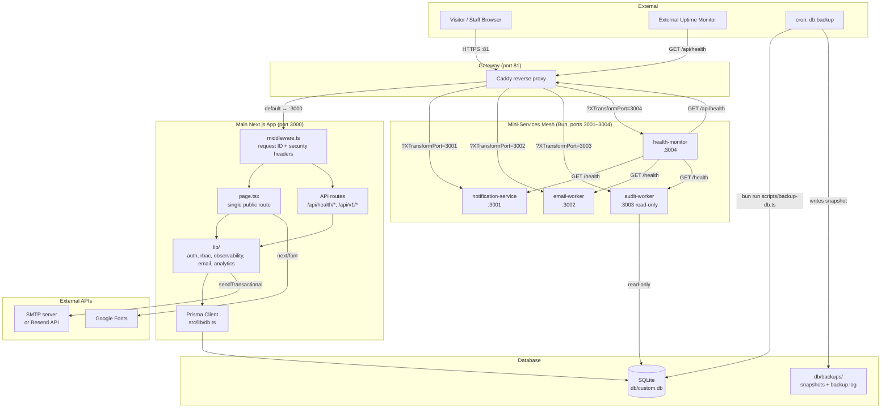
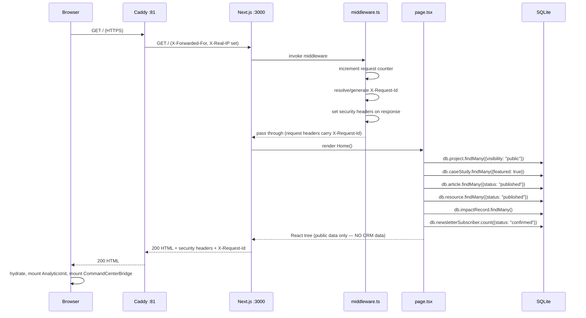
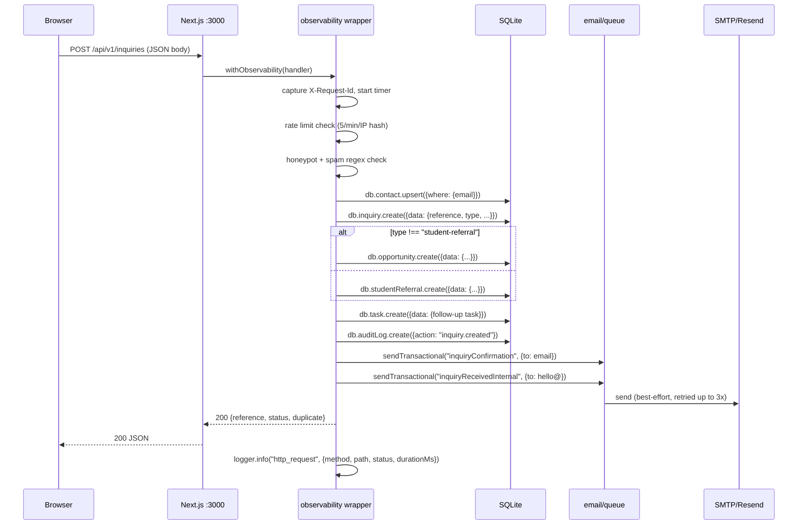
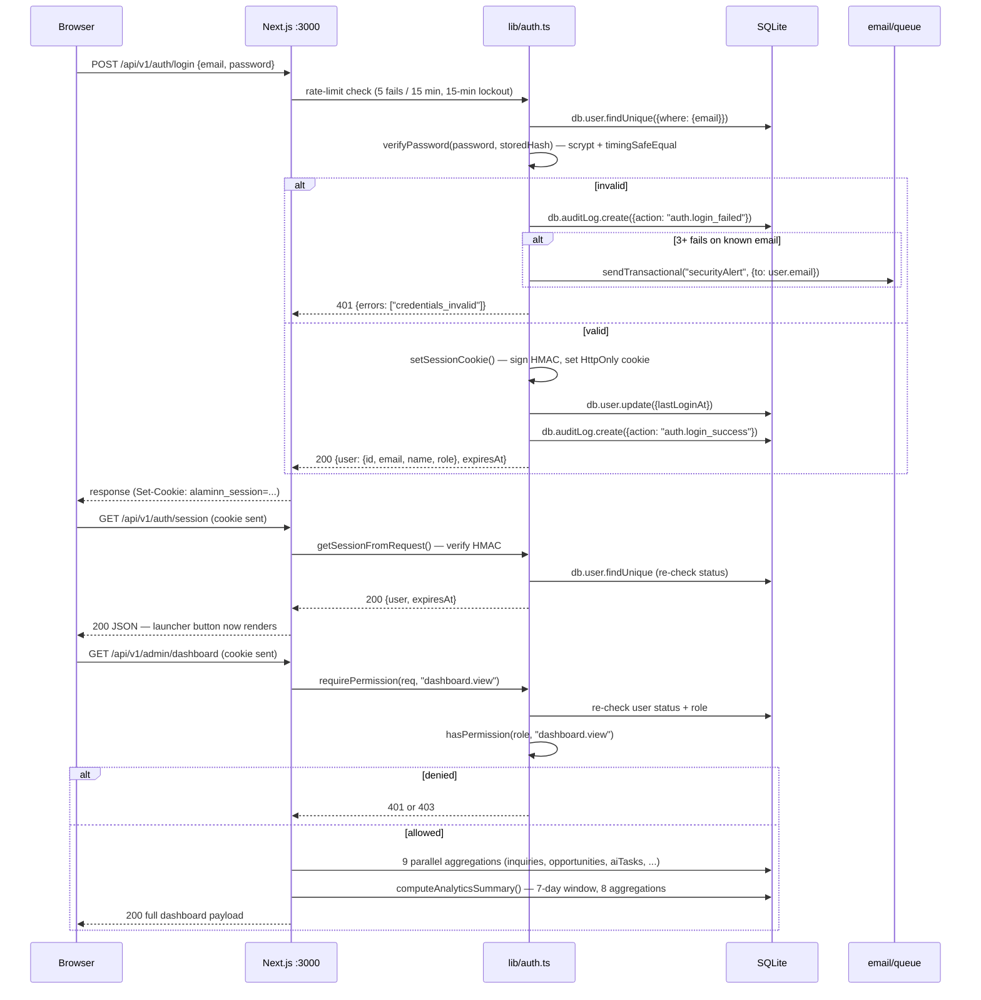
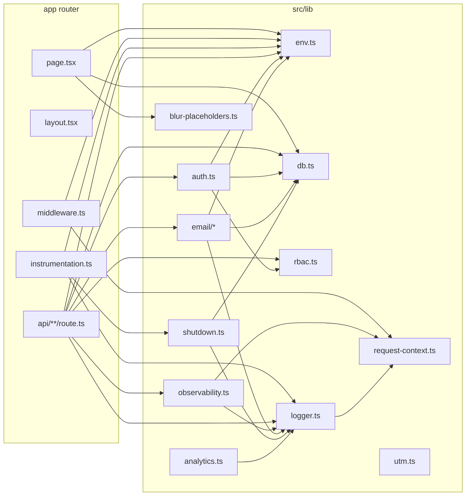
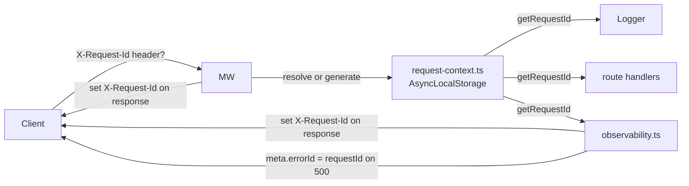

# System Architecture — Alaminn.info V5

This document describes the high-level architecture of Alaminn.info: the
deployment topology, the request flow from browser to DB, the component
hierarchy of the single public route, and the single-route constraint that
governs the entire UX.

---

## 1. System Diagram



### Legend

- **Solid arrows** = HTTP requests.
- The main app (port 3000) is the only externally-exposed service.
- The four mini-services (ports 3001–3004) are reachable from the browser
  via the Caddy gateway using `?XTransformPort=<port>` on a relative URL.
- The audit-worker opens the SQLite DB **read-only** — it cannot mutate
  production data.
- The health-monitor polls every endpoint every 30s and retains the last
  100 check rounds in memory.

---

## 2. Request Flow

### 2.1 Public page load



**Key invariants:**

- The public HTML/JS bundle contains **only public content**. No CRM data
  (inquiries, contacts, AI tasks, audit logs) is shipped to the browser.
- The Command Center launcher button is rendered only after the client
  confirms a valid session via `GET /api/v1/auth/session`.

### 2.2 Public form submission (inquiry example)



**Key invariants:**

- Email failure **never** crashes the inquiry submission. `sendTransactional`
  is wrapped in `.catch(() => null)` at the call site, and the underlying
  transport never throws.
- Every step is wrapped in `withObservability` which catches unhandled
  exceptions and returns a 500 with `meta.errorId = requestId` for log
  correlation.

### 2.3 Authenticated Command Center login



**Key invariants:**

- `requirePermission` re-checks the user's status AND role against the DB on
  every privileged request — a suspended or demoted user loses access
  immediately, even mid-session.
- The dashboard payload includes a 7-day analytics summary computed
  server-side from anonymous `AnalyticsEvent` rows.

---

## 3. Component Hierarchy

The single public route (`src/app/page.tsx`) mounts this tree:

```mermaid
graph TD
  Root["RootLayout<br/>src/app/layout.tsx"] --> Theme[ThemeProvider next-themes]
  Root --> JSONLDB1[JSON-LD script tag]
  Root --> Fonts[Inter + Manrope + DM Serif Display]
  Root --> Toaster[Toaster]
  Root --> Preload[link rel=preload portrait.jpg]

  Home["Home<br/>src/app/page.tsx"] --> JsonLdComp[JsonLd component]
  Home --> Navbar
  Home --> Main
  Home --> Footer
  Home --> Bridge[CommandCenterBridge]
  Home --> Scroll[ScrollUtilities]
  Home --> Analytics[AnalyticsInit]

  Main --> Hero
  Main --> Stats[StatsTicker]
  Main --> ExecIntro[ExecutiveIntro]
  Main --> Expertise
  Main --> WorkSystem
  Main --> Impact
  Main --> Ecosystem
  Main --> CaseStudies
  Main --> Testimonials
  Main --> AloLabs
  Main --> AudiencePathways
  Main --> Insights
  Main --> Resources
  Main --> Faq
  Main --> Verification
  Main --> Profile
  Main --> WorkWithMe
  Main --> Newsletter
  Home --> Contact[ContactFinale]

  Bridge --> CC[CommandCenter modal]
  Bridge --> Chrome[SiteChrome keyboard shortcuts]

  Navbar --> SearchPalette[SearchPalette Cmd+K]
  Navbar --> ThemeToggle
  Navbar --> MobileDrawer

  CC --> LoginForm
  CC --> Dashboard
  CC --> AIWorkspace
  CC --> Approvals
  CC --> Audit
```



### Key components

| Component | File | Role |
| --- | --- | --- |
| `RootLayout` | `src/app/layout.tsx` | Fonts, metadata, JSON-LD, ThemeProvider, Toaster, portrait preload |
| `Home` | `src/app/page.tsx` | The single public route — fetches public data, mounts the section tree |
| `Navbar` | `src/components/site/navbar.tsx` | Sticky nav with scroll-spy, mega menu, mobile drawer, theme toggle, search palette trigger |
| `Footer` | `src/components/site/footer.tsx` | Sticky footer (`mt-auto` on the flex-col root) |
| `CommandCenterBridge` | `src/components/site/command-center-bridge.tsx` | Mounts the Command Center + SiteChrome (keyboard shortcuts) |
| `CommandCenter` | `src/components/site/command-center.tsx` | The CRM/AI/Approvals/Audit dashboard modal — only renders the launcher button when authenticated |
| `ScrollUtilities` | `src/components/site/scroll-utilities.tsx` | Scroll-progress bar + back-to-top button |
| `AnalyticsInit` | `src/components/site/analytics-init.tsx` | Mounts the privacy-friendly client-side tracker |
| `JsonLd` | `src/components/site/json-ld.tsx` | Person + WebSite + ProfilePage + BreadcrumbList structured data |
| `Hero` | `src/components/site/sections/hero.tsx` | Headline + Operating Constellation SVG |
| `Constellation` | `src/components/site/constellation.tsx` | Animated SVG — Al Aminn at center, 8 surrounding nodes |
| `ScheduleMeetingModal` | `src/components/site/schedule-meeting-modal.tsx` | 3-step meeting booking flow |
| `DetailModal` | `src/components/site/detail-modal.tsx` | Reusable modal for project/article/case-study/expertise/resource detail (no separate routes) |
| `SearchPalette` | `src/components/site/search-palette.tsx` | Cmd+K palette — searches public articles + projects |

---

## 4. Single-Route Constraint

This project enforces a hard constraint: **the only user-facing route is `/`**.
There is no `/about`, `/expertise/{slug}`, `/projects/{slug}`, etc.

### 4.1 Why?

The original spec called for a single-page premium experience. Multiple
routes would:

- Fragment the "executive authority platform" narrative across pages.
- Force full page reloads that break the scroll-driven storytelling.
- Add SEO complexity (per-page metadata, sitemap entries, canonical URLs).
- Increase the bundle size (each route ships its own JS chunk).

### 4.2 How "detail pages" work

Detail content (project breakdowns, article bodies, case-study deep dives,
expertise descriptions, resource metadata) is rendered in **modal overlays**
on top of the homepage:

```tsx
<DetailModal open={open} onClose={close}>
  <ModalField label="Business Problem">…</ModalField>
  <ModalField label="My Role">…</ModalField>
  <ModalField label="Solution">…</ModalField>
  <ModalField label="Outcome">…</ModalField>
</DetailModal>
```

Clicking a card in `Ecosystem`, `CaseStudies`, `Impact`, `Expertise`,
`Resources`, `Insights`, `WorkWithMe`, or `AloLabs` opens a `DetailModal`
with the full content — no navigation, no full reload.

### 4.3 What this means for the API

- Public content is fetched server-side in `page.tsx`'s `getPublicData()` and
  shipped in the initial HTML.
- The `GET /api/v1/public/articles` and `GET /api/v1/public/projects`
  endpoints exist for the Cmd+K search palette to query live content without
  a page reload.
- All CRM data is fetched client-side after authentication — there is no
  server-rendered CRM view.

### 4.4 What's exempt

- `/api/*` — machine endpoints, not user-facing.
- `/_next/*` — Next.js internal assets.
- `/favicon.svg`, `/logo.svg`, `/brand/*`, `/icon`, `/apple-icon` — static
  assets.
- `/sitemap.xml`, `/robots.txt` — generated by `src/app/sitemap.ts` and
  `src/app/robots.ts` (these are Next.js metadata routes, not page routes).

### 4.5 Hash-based "navigation"

In-page navigation uses URL hashes (`#about`, `#impact`, `#insights`,
`#staff`, `#newsletter?verified=1`). The navbar's scroll-spy highlights the
active section as the user scrolls. The browser's back/forward buttons work
correctly with hashes.

---

## 5. Module Dependency Graph



### Key invariants

- `env.ts` is the **only** module that reads `process.env`. Every other
  module imports the typed `env()` accessor.
- `auth.ts` and `rbac.ts` are the **only** modules that reason about roles
  and permissions.
- `db.ts` is the **only** module that instantiates `PrismaClient`. Every
  other module imports the singleton `db` from `@/lib/db`.
- The `observability.ts` HOC wraps every public-form and admin route handler.
  It captures the request ID, times the handler, catches unhandled exceptions,
  and logs the outcome.
- `instrumentation.ts` runs once at server startup (before any request). It
  validates env, installs shutdown handlers, and wires the logger. It is
  bundled for both Node.js and Edge runtimes — Edge-unsafe code (e.g.
  `process.exit`) is dynamically imported behind a `NEXT_RUNTIME === "nodejs"`
  guard.

---

## 6. Caddy Gateway & `XTransformPort`

The sandbox exposes a single external port. The bundled `Caddyfile` listens
on `:81` and routes traffic to the main app (`:3000`) by default. To reach
any mini-service from the browser, append `?XTransformPort=<port>` to a
relative URL:

```
GET /notifications?XTransformPort=3001   → notification-service
GET /queue?XTransformPort=3002           → email-worker
GET /report?XTransformPort=3003          → audit-worker
GET /status?XTransformPort=3004          → health-monitor
```

The Caddyfile:

```caddy
:81 {
  @transform_port_query {
    query XTransformPort=*
  }
  handle @transform_port_query {
    reverse_proxy localhost:{query.XTransformPort} { … }
  }
  handle {
    reverse_proxy localhost:3000 { … }
  }
}
```

### Rules

- **Always use relative URLs from the browser.** Never `http://localhost:3001`
  — that address is internal and not externally reachable.
- **Never write the port in the URL path.** Only in the `XTransformPort`
  query parameter.
- For socket.io (if used): `io("/?XTransformPort=3003")` — path is always
  `/`, port goes in the query.

---

## 7. Mini-Services Mesh

The four sidecar services under `mini-services/` are independent Bun
projects, each with its own `package.json` and `index.ts`. They share no
state with the main app except reading the same SQLite DB (audit-worker is
read-only).

### 7.1 Service overview

| Service | Port | Purpose | State |
| --- | --- | --- | --- |
| `notification-service` | 3001 | In-memory notification ingestion. `POST /notify`, `GET /notifications`, `GET /health`. | FIFO log capped at 1000 (in-memory). |
| `email-worker` | 3002 | Retry queue with exponential backoff (2s → 4s → 8s → 16s → 32s, cap 60s, max 6 attempts). `POST /queue`, `GET /queue`, `POST /retry/:id`, `DELETE /queue/:id`, `GET /health`. | In-memory queue. Simulated sender (does NOT actually send SMTP — the main app's real transport lives in `src/lib/email/transport.ts`). |
| `audit-worker` | 3003 | Read-only audit log reports & export. Opens `db/custom.db` in read-only mode. `GET /report?from=&to=`, `GET /export?format=json\|csv`, `GET /health`. | Reads from SQLite. No writes. |
| `health-monitor` | 3004 | Mesh monitor — pings main + 3001/3002/3003 every 30s. `GET /status`, `GET /health`, `GET /metrics`. | Retains last 100 check rounds in-memory. |

### 7.2 Process startup

Services are launched with a true POSIX double-fork so they survive across
shell sessions (the sandbox reaps simple background processes):

```bash
( cd /home/z/my-project/mini-services/<name> && bun --hot index.ts </dev/null >/tmp/<name>.log 2>&1 & )
```

The inner `( ... & )` subshell backgrounds `bun` and immediately exits,
orphaning it to PID 1 so it persists across subsequent Bash tool calls.

### 7.3 Health-check loop (health-monitor)

Every 30 seconds, the health-monitor fetches:

- `http://localhost:3000/api/health` (main app)
- `http://localhost:3001/health` (notification-service)
- `http://localhost:3002/health` (email-worker)
- `http://localhost:3003/health` (audit-worker)
- `http://localhost:3004/health` (itself)

With a 5-second timeout per request. The last 100 check rounds are retained
in memory and surfaced via `GET /status`. Any down target triggers a warning
in the status output.

---

## 8. Observability

### 8.1 Request ID propagation



- The middleware honors an inbound `X-Request-Id` header (set by upstream
  proxies or test harnesses). If absent, it generates a UUID.
- The ID is propagated to the route handler via a rewritten request header.
- The route handler runs inside an `AsyncLocalStorage` context
  (`runWithRequestId`) so `getRequestId()` works anywhere downstream —
  logging, error blocks, downstream services.
- The ID is echoed on the response (`X-Request-Id` header) for client-side
  correlation.
- On 500 responses, `meta.errorId` carries the request ID so support staff
  can grep the logs for the exact failure.

### 8.2 Structured logging

`src/lib/logger.ts` emits:

- **Production:** single-line JSON to stdout (info/debug) or stderr (error).
  Suitable for log shippers like Datadog / Loki / CloudWatch.
- **Development:** colored, human-readable line with optional meta JSON.

Every log line includes:

```json
{
  "timestamp": "2026-07-12T03:00:00.000Z",
  "level": "info",
  "message": "http_request",
  "requestId": "abc-123",
  "method": "POST",
  "path": "/api/v1/inquiries",
  "status": 200,
  "durationMs": 42
}
```

Min level is configurable via `LOG_LEVEL` (debug|info|warn|error). Defaults
to `info` in prod, `debug` in dev.

### 8.3 Graceful shutdown

`src/lib/shutdown.ts` installs `SIGTERM` and `SIGINT` handlers that:

1. Log `"Shutting down gracefully..."`.
2. Call `db.$disconnect()` to close the Prisma connection.
3. Force-exit after 5 seconds if cleanup hangs.

The handler is idempotent (`_installed` guard) — safe to call multiple times.

`src/instrumentation.ts` calls `setupShutdownHandlers()` once at server
startup. The `process.exit` call lives in `shutdown.ts` (not
`instrumentation.ts`) so the Edge runtime bundler doesn't warn about its
presence — `instrumentation.ts` is bundled for both Node.js and Edge.

---

## 9. Image Pipeline

```mermaid
graph LR
  Source[/public/brand/portrait.jpg<br/>+ portrait-lifestyle.jpg] --> Sharp1[scripts/generate-modern-images.ts<br/>sharp]
  Sharp1 --> WebP[portrait.webp]
  Sharp1 --> AVIF[portrait.avif]
  Sharp1 --> WebPL[portrait-lifestyle.webp]
  Sharp1 --> AVIFL[portrait-lifestyle.avif]

  Source --> Sharp2[scripts/generate-blur-placeholders.ts<br/>sharp]
  Sharp2 --> BlurTS[src/lib/blur-placeholders.ts<br/>generated TS module]

  Profile[profile.tsx] -->|next/image| NextImage[/_next/image optimizer]
  NextImage -->|AVIF first, WebP fallback| Browser
  Profile -->|blurDataURL| BlurTS
  Profile -->|quality=85| NextImage

  Layout[layout.tsx] -->|link rel=preload as=image| Source
```

- `next.config.ts` declares `images.formats: ['image/avif', 'image/webp']`
  and `images.qualities: [75, 85]` (75 default, 85 for brand portraits).
- `next/image`'s `/_next/image` optimizer serves AVIF when the browser's
  `Accept` header includes it, falling back to WebP.
- The portrait (LCP candidate) uses `priority` + `placeholder="blur"` +
  a generated `blurDataURL`. The lifestyle image uses `loading="lazy"`.
- A static `<link rel="preload" as="image" href="/brand/portrait.jpg"
  fetchPriority="high">` in `layout.tsx` covers the OG/Twitter metadata
  fetch path (different URL from the optimized `/_next/image` URL — no
  duplicate requests).
- Manrope (display) is preloaded via `next/font`'s `preload: true`. Inter
  and DM Serif Display skip preload (Next.js only allows one preloaded font).

---

## 10. Build Output

`bun run build` produces a self-contained standalone server bundle:

```
.next/standalone/
├── server.js              # The production server entry point
├── package.json           # Minimal deps manifest
├── node_modules/          # Bundled dependencies
├── .next/
│   └── static/            # Copied by the build script
└── public/                # Copied by the build script
```

The build script in `package.json`:

```bash
next build && cp -r .next/static .next/standalone/.next/ && cp -r public .next/standalone/
```

Run the production server with:

```bash
NODE_ENV=production bun .next/standalone/server.js
```

(Or `bun run start`, which is `NODE_ENV=production bun .next/standalone/server.js 2>&1 | tee server.log`.)

---

## 11. Deployment Topology (single host)

The current deployment is a single host:

- **Port 81** — Caddy (TLS termination, gateway).
- **Port 3000** — Next.js (main app).
- **Port 3001** — notification-service (Bun).
- **Port 3002** — email-worker (Bun).
- **Port 3003** — audit-worker (Bun).
- **Port 3004** — health-monitor (Bun).

All processes run on the same host. SQLite is a single file at
`db/custom.db`. Backups are written to `db/backups/` and replicated off-host
via rsync/S3 (recommended; see [disaster-recovery.md](./disaster-recovery.md)).

### Scaling beyond a single host

The architecture is single-host by design — SQLite is the bottleneck. To
scale horizontally:

1. Replace SQLite with Postgres (update `prisma/schema.prisma` datasource).
2. Replace in-memory rate limits with Redis.
3. Replace in-memory session validation cache with a shared store (or use
   stateless JWTs).
4. Run the main app + mini-services as containers behind a load balancer.
5. Move the audit-worker to a read-replica of the DB.

These changes are not currently planned — the single-host topology is
sufficient for the expected traffic.
