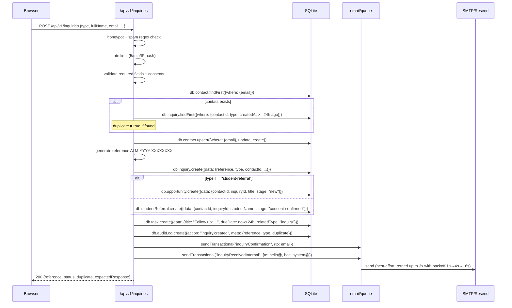
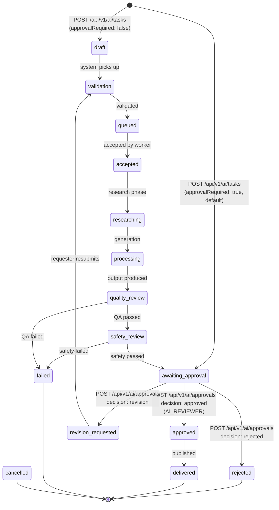

# Database Schema — Alaminn.info V5

Implementation: `prisma/schema.prisma`. SQLite via Prisma Client v6.

This document covers all 18 Prisma models, the entity-relationship diagram,
the inquiry pipeline (the most important write path), and the AI governance
flow (the approval workflow for AI-generated content).

---

## 1. Models Overview

The schema is organized into 6 logical groups:

| Group | Models | Purpose |
| --- | --- | --- |
| Identity & Auth | `User`, `Contact`, `Organization` | People who can sign in, people who submit forms, partner orgs |
| Inquiries & CRM | `Inquiry`, `Opportunity`, `Partnership`, `StudentReferral`, `Task`, `Note`, `NewsletterSubscriber` | The CRM pipeline |
| Content | `Project`, `Article`, `Resource`, `ImpactRecord`, `CaseStudy` | Public-facing content |
| AI Workspace | `AiTask`, `AiApproval` | AI generation requests + human-in-the-loop approvals |
| Audit & Logs | `AuditLog`, `SystemHealth` | Append-only audit trail + health checks |
| Meetings | `MeetingRequest` | Public meeting-request submissions |
| Analytics | `AnalyticsEvent` | Privacy-friendly first-party event log |

Total: **18 models**.

---

## 2. ER Diagram

```mermaid
erDiagram
  User ||--o{ Inquiry : "createdBy"
  User ||--o{ AiTask : "requester"
  User ||--o{ AiApproval : "reviewer"
  User ||--o{ AuditLog : "actor"
  User ||--o{ Task : "assignee"
  User ||--o{ Note : "author"

  Contact ||--o{ Inquiry : "submits"
  Contact ||--o{ Opportunity : "owns"
  Contact ||--o{ StudentReferral : "refers"
  Contact ||--o{ Task : "related"
  Contact ||--o{ Note : "about"

  Organization ||--o{ Partnership : "has"

  Inquiry ||--o| Opportunity : "becomes"
  Inquiry ||--o| StudentReferral : "routes to (referral type)"

  AiTask ||--o{ AiApproval : "has"

  Project ||--o{ ImpactRecord : "evidenced by"

  User {
    string id PK
    string email UK
    string name
    string role
    string status
    string passwordHash
    datetime lastLoginAt
    datetime createdAt
    datetime updatedAt
  }

  Contact {
    string id PK
    string fullName
    string email UK
    string phone
    string whatsapp
    string organization
    string role
    string country
    string city
    string preferredChannel
    string tags
    string status
    string source
    datetime createdAt
    datetime updatedAt
  }

  Inquiry {
    string id PK
    string reference UK
    string type
    string contactId FK
    string createdById FK
    string currentChallenge
    string desiredOutcome
    string timeline
    string scope
    string existingSystem
    string preferredTime
    string notes
    string utmSource
    string utmMedium
    string utmCampaign
    string referralSource
    boolean privacyConsent
    boolean commsConsent
    boolean marketingConsent
    boolean studentDataConsent
    string status
    string ipHash
    datetime createdAt
    datetime updatedAt
  }

  Opportunity {
    string id PK
    string contactId FK
    string inquiryId FK
    string title
    int value
    string currency
    string stage
    string priority
    datetime closeDate
    datetime createdAt
    datetime updatedAt
  }

  Partnership {
    string id PK
    string organizationId FK
    string name
    string type
    string stage
    string alAminnRole
    string problemSolved
    string status
    datetime createdAt
    datetime updatedAt
  }

  StudentReferral {
    string id PK
    string contactId FK
    string inquiryId FK
    string studentName
    string interestCountry
    string interestProgram
    boolean consent
    string stage
    datetime createdAt
    datetime updatedAt
  }

  Task {
    string id PK
    string title
    string description
    datetime dueDate
    string priority
    string status
    string assigneeId FK
    string contactId FK
    string relatedType
    string relatedId
    datetime createdAt
    datetime updatedAt
  }

  Note {
    string id PK
    string body
    string contactId FK
    string authorId FK
    datetime createdAt
    datetime updatedAt
  }

  NewsletterSubscriber {
    string id PK
    string email UK
    string name
    string interest
    boolean consent
    string status
    string token UK
    datetime createdAt
    datetime updatedAt
  }

  Project {
    string id PK
    string slug UK
    string name
    string subtitle
    string category
    string shortDescription
    string fullDescription
    string businessProblem
    string approvedRole
    string responsibilities
    string solution
    string architecture
    string technologies
    string workflows
    string outputs
    string outcomes
    string evidenceStatus
    string confidentiality
    string status
    string approvedUrl
    string logo
    string coverMedia
    string gallery
    boolean featured
    string visibility
    datetime startDate
    datetime endDate
    datetime createdAt
    datetime updatedAt
  }

  Article {
    string id PK
    string slug UK
    string title
    string summary
    string body
    string category
    string tags
    string author
    int readingMinutes
    string verificationStatus
    string status
    datetime publishedAt
    datetime updatedAt
    boolean featured
    string coverMedia
  }

  Resource {
    string id PK
    string slug UK
    string title
    string description
    string category
    string type
    string fileUrl
    int readTime
    string status
    datetime createdAt
    datetime updatedAt
  }

  ImpactRecord {
    string id PK
    string category
    string challenge
    string role
    string action
    string outcome
    string evidenceStatus
    string confidentiality
    string projectId FK
    datetime date
    datetime createdAt
    datetime updatedAt
  }

  CaseStudy {
    string id PK
    string slug UK
    string title
    string category
    string context
    string challenge
    string role
    string intervention
    string systemBuilt
    string outcome
    string evidenceStatus
    string confidentiality
    int readTime
    boolean featured
    datetime createdAt
    datetime updatedAt
  }

  AiTask {
    string id PK
    string requesterId FK
    string workflow
    string project
    string objective
    string prompt
    string sensitivity
    string outputFormat
    boolean approvalRequired
    string reviewerId FK
    datetime deadline
    string status
    string result
    datetime createdAt
    datetime completedAt
  }

  AiApproval {
    string id PK
    string taskId FK
    string reviewerId FK
    string decision
    string note
    datetime createdAt
  }

  AuditLog {
    string id PK
    string actorId FK
    string action
    string resource
    string resourceId
    string meta
    string ipHash
    datetime createdAt
  }

  SystemHealth {
    string id PK
    string component
    string status
    string message
    datetime checkedAt
  }

  MeetingRequest {
    string id PK
    string reference UK
    string meetingType
    datetime requestedDate
    string requestedTime
    string timezone
    string contactName
    string contactEmail
    string organization
    string topic
    string status
    string ipHash
    string utmSource
    string utmMedium
    string utmCampaign
    string notes
    datetime createdAt
    datetime updatedAt
  }

  AnalyticsEvent {
    string id PK
    datetime createdAt
    string eventName
    string page
    string referrer
    string utmSource
    string utmMedium
    string utmCampaign
    string utmContent
    string utmTerm
    string sessionId
    string ipHash
    string meta
  }
```



---

## 3. Identity & Auth

### 3.1 `User`

Staff accounts. Created by an OWNER or SUPER_ADMIN from the Command Center,
or provisioned via `scripts/seed-admin.ts` (OWNER only).

| Field | Type | Notes |
| --- | --- | --- |
| `id` | `String @id @default(cuid())` | |
| `email` | `String @unique` | Lowercased before storage |
| `name` | `String` | Display name |
| `role` | `String @default("VIEWER")` | One of 11 `UserRole` values (see [security.md §2](./security.md#2-rbac--role-based-access-control)) |
| `status` | `String @default("active")` | `active` \| `suspended` \| `inactive`. `suspended` invalidates sessions on next `getSession()` call. |
| `passwordHash` | `String?` | `scrypt$salt$hash` format. Nullable to support future passwordless accounts. |
| `lastLoginAt` | `DateTime?` | Updated on successful login |
| `createdAt` / `updatedAt` | `DateTime` | |

**Relations:** `inquiries` (created by), `aiTasks` (requested), `aiApprovals`
(reviewed), `auditLogs` (actor), `tasks` (assigned), `notes` (author).

### 3.2 `Contact`

Public-form submitters. Created or updated (upsert by email) on every
inquiry / meeting / newsletter submission.

| Field | Type | Notes |
| --- | --- | --- |
| `id` | `String @id` | |
| `fullName` | `String` | |
| `email` | `String @unique` | Lowercased |
| `phone`, `whatsapp` | `String?` | |
| `organization`, `role`, `country`, `city` | `String?` | |
| `preferredChannel` | `String?` | `email` \| `phone` \| `whatsapp` |
| `tags` | `String?` | Comma-separated |
| `status` | `String @default("active")` | `active` \| `nurturing` \| `converted` \| `archived` |
| `source` | `String?` | UTM source / referral |

### 3.3 `Organization`

Partner organizations (universities, education businesses, companies, media,
partners). Currently informational — not created by public forms.

| Field | Type | Notes |
| --- | --- | --- |
| `id`, `name` | `String` | |
| `type` | `String?` | `university` \| `education-business` \| `company` \| `media` \| `partner` |
| `country`, `website` | `String?` | |
| `status` | `String @default("active")` | |

---

## 4. Inquiries & CRM

### 4.1 `Inquiry`

The core CRM record. Created by `POST /api/v1/inquiries`.

| Field | Type | Notes |
| --- | --- | --- |
| `id` | `String @id` | |
| `reference` | `String @unique` | `ALM-YYYY-XXXXXXXX` (8 hex chars). Generated server-side. |
| `type` | `String` | See enum below |
| `contactId` | `String` (FK → `Contact`) | |
| `createdById` | `String?` (FK → `User`) | Null for public submissions |
| `currentChallenge`, `desiredOutcome`, `timeline`, `scope`, `existingSystem`, `preferredTime`, `notes` | `String?` | Form fields |
| `utmSource`, `utmMedium`, `utmCampaign` | `String?` | Marketing attribution |
| `referralSource` | `String?` | Free-text "how did you hear about us" |
| `privacyConsent`, `commsConsent`, `marketingConsent`, `studentDataConsent` | `Boolean` | Required consents |
| `status` | `String @default("new")` | `new` \| `reviewing` \| `qualified` \| `responded` \| `converted` \| `archived` |
| `ipHash` | `String?` | sha256 of IP, truncated to 16 hex chars |

**Inquiry `type` enum (13 values):**

```
university-partnership | business-consultation | operations-review |
sales-strategy | education-advisory | ai-automation | crm-digital |
tech-collaboration | personal-branding | speaking | media |
student-referral | other
```

### 4.2 `Opportunity`

Sales-pipeline record. Auto-created from non-referral inquiries.

| Field | Type | Notes |
| --- | --- | --- |
| `id` | `String @id` | |
| `contactId` | `String` (FK → `Contact`) | |
| `inquiryId` | `String? @unique` (FK → `Inquiry`) | One-to-one |
| `title` | `String` | Auto-generated as `${type} — ${contact.fullName}` |
| `value` | `Int?` | Estimated value |
| `currency` | `String @default("USD")` | |
| `stage` | `String @default("new")` | See enum below (14 stages) |
| `priority` | `String @default("medium")` | `low` \| `medium` \| `high` \| `critical` |
| `closeDate` | `DateTime?` | |

**Opportunity `stage` enum (14 values):**

```
new | review-required | qualified | discovery-scheduled | discovery-completed |
scope-required | proposal-drafting | proposal-sent | negotiation | approved |
in-progress | won | lost | on-hold | archived
```

### 4.3 `Partnership`

University / institutional / tech / media partnerships. Currently
informational — managed from the Command Center by roles with
`partnerships.update`.

| Field | Type | Notes |
| --- | --- | --- |
| `id`, `name` | `String` | |
| `organizationId` | `String` (FK → `Organization`) | |
| `type` | `String?` | `university-partnership` \| `institutional-collaboration` \| `tech-partner` \| `media` |
| `stage` | `String @default("new-institution")` | 10-stage pipeline |
| `alAminnRole`, `problemSolved` | `String?` | |
| `status` | `String @default("planned")` | `planned` \| `in-testing` \| `connected` \| `active` \| `on-hold` |

### 4.4 `StudentReferral`

Routes student-referral inquiries to the ALO Education pipeline. Auto-created
when `Inquiry.type === "student-referral"`.

| Field | Type | Notes |
| --- | --- | --- |
| `id` | `String @id` | |
| `contactId` | `String` (FK → `Contact`) | |
| `inquiryId` | `String? @unique` (FK → `Inquiry`) | |
| `studentName` | `String` | |
| `interestCountry`, `interestProgram` | `String?` | |
| `consent` | `Boolean @default(false)` | |
| `stage` | `String @default("new-referral")` | 11-stage pipeline |

**`stage` enum:** `new-referral` | `consent-pending` | `consent-confirmed` |
`sent-to-alo-education` | `accepted` | `counselor-assigned` | `in-progress`
| `converted` | `closed` | `duplicate` | `consent-withdrawn`

### 4.5 `Task`

Follow-up tasks. Auto-created on inquiry submission ("Follow up: ${name}
(${reference})"). Also manually creatable from the Command Center.

| Field | Type | Notes |
| --- | --- | --- |
| `id`, `title`, `description` | `String` | |
| `dueDate` | `DateTime?` | |
| `priority` | `String @default("medium")` | |
| `status` | `String @default("open")` | `open` \| `in-progress` \| `done` \| `overdue` \| `cancelled` |
| `assigneeId` | `String?` (FK → `User`) | |
| `contactId` | `String?` (FK → `Contact`) | |
| `relatedType` | `String?` | `inquiry` \| `opportunity` \| `partnership` \| `project` \| `ai-task` |
| `relatedId` | `String?` | Polymorphic — refers to the related record's `id` |

### 4.6 `Note`

Free-text notes on contacts, authored by users.

### 4.7 `NewsletterSubscriber`

Newsletter signups. `pending` → `confirmed` via the email verification flow.

| Field | Type | Notes |
| --- | --- | --- |
| `id`, `email` (`@unique`), `name?`, `interest?` | | |
| `consent` | `Boolean @default(false)` | |
| `status` | `String @default("pending")` | `pending` \| `confirmed` \| `unsubscribed` |
| `token` | `String @unique` | 32-char hex; null after verification |

---

## 5. Content

All content models share a `slug` (URL-safe unique identifier), a
`status`/`verificationStatus`/`evidenceStatus` field, and a
`confidentiality` level (where applicable).

### 5.1 `Project`

Public-facing portfolio entries. The 15-field structure (business problem,
approved role, responsibilities, solution, architecture, technologies,
workflows, outputs, outcomes, evidence status, confidentiality, etc.) is
rendered in the `Ecosystem` section's detail modal.

| Field | Type | Notes |
| --- | --- | --- |
| `slug` | `String @unique` | |
| `category` | `String` | `education` \| `ai` \| `software` \| `crm` \| `automation` \| `marketing` \| `research` \| `professional-brand` \| `client-work` |
| `evidenceStatus` | `String @default("unverified")` | `unverified` \| `evidence-uploaded` \| `under-review` \| `verified` \| `expired` \| `rejected` \| `archived` |
| `confidentiality` | `String @default("public")` | `public` \| `partially-anonymized` \| `fully-anonymized` \| `summary-only` \| `private` |
| `visibility` | `String @default("public")` | `public` \| `private` — only `public` projects are listed in `page.tsx` |
| `featured` | `Boolean @default(false)` | |

### 5.2 `Article`

Editorial content. `status: "published"` is the only status surfaced on the
public site (`page.tsx` filters on it).

| Field | Type | Notes |
| --- | --- | --- |
| `category` | `String` | 11 categories (executive-leadership, business-operations, sales-growth, international-education, university-partnerships, bangladesh-market, ai-automation, crm-technology, digital-marketing, personal-branding, professional-development) |
| `verificationStatus` | `String @default("verified")` | |
| `status` | `String @default("published")` | `draft` \| `review` \| `approved` \| `scheduled` \| `published` \| `archived` |
| `author` | `String @default("Al Aminn")` | |
| `readingMinutes` | `Int @default(5)` | |
| `featured` | `Boolean @default(false)` | |

### 5.3 `Resource`

Downloadable resources (guides, templates, checklists, reports, videos).
`status: "published"` is the only status surfaced on the public site.

### 5.4 `ImpactRecord`

Outcome records — challenge → role → action → outcome. Used in the `Impact`
section. Each record links optionally to a `Project`.

### 5.5 `CaseStudy`

Long-form case studies. Featured case studies are surfaced in the
`CaseStudies` section.

---

## 6. AI Workspace

### 6.1 `AiTask`

AI generation requests. Created by roles with `ai_tasks.create`
(`EXECUTIVE_ASSISTANT`, `SUPER_ADMIN`, `OWNER`). Reviewed by roles with
`ai_approvals.decide` (`AI_REVIEWER`, `SUPER_ADMIN`, `OWNER`).

| Field | Type | Notes |
| --- | --- | --- |
| `id` | `String @id` | |
| `requesterId` | `String` (FK → `User`) | |
| `workflow` | `String` | One of 44 approved workflows (see `APPROVED_WORKFLOWS` in `src/app/api/v1/ai/tasks/route.ts`) |
| `project` | `String?` | Optional project slug |
| `objective` | `String` | What the requester wants the AI to produce |
| `prompt` | `String` | Full prompt (defaults to objective) |
| `sensitivity` | `String @default("internal")` | `public` \| `internal` \| `confidential` \| `low` \| `medium` \| `high` |
| `outputFormat` | `String @default("markdown")` | `markdown` \| `html` \| `json` \| `plain-text` |
| `approvalRequired` | `Boolean @default(true)` | If false, task starts in `draft` status |
| `reviewerId` | `String?` (FK → `User`) | Set when a decision is made |
| `deadline` | `DateTime?` | |
| `status` | `String @default("draft")` | See enum below (14 statuses) |
| `result` | `String?` | The AI-generated output (populated after generation) |
| `completedAt` | `DateTime?` | |

**`status` enum (14 values):**

```
draft | validation | queued | accepted | researching | processing |
quality-review | safety-review | awaiting-approval | revision-requested |
approved | rejected | delivered | failed | cancelled
```

### 6.2 `AiApproval`

One row per approval decision. Multiple rows can exist for a single task
(e.g., revision → re-approval creates two rows).

| Field | Type | Notes |
| --- | --- | --- |
| `id` | `String @id` | |
| `taskId` | `String` (FK → `AiTask`) | |
| `reviewerId` | `String?` (FK → `User`) | |
| `decision` | `String?` | `approved` \| `rejected` \| `revision` |
| `note` | `String?` | Reviewer's note |
| `createdAt` | `DateTime` | |

---

## 7. Audit & Logs

### 7.1 `AuditLog`

Append-only audit trail. See [security.md §6](./security.md#6-audit-logging)
for the full list of audited actions.

| Field | Type | Notes |
| --- | --- | --- |
| `id` | `String @id` | |
| `actorId` | `String?` (FK → `User`) | Null for anonymous/system actions |
| `action` | `String` | e.g. `auth.login_success`, `inquiry.created`, `ai-task.approved` |
| `resource` | `String?` | e.g. `user`, `inquiry`, `ai-task` |
| `resourceId` | `String?` | The related record's `id` |
| `meta` | `String?` | JSON string with action-specific data |
| `ipHash` | `String?` | sha256 of client IP, truncated to 16 hex chars |
| `createdAt` | `DateTime @default(now())` | |

### 7.2 `SystemHealth`

Component health snapshots. Not actively written by the current build —
reserved for future use by a background health-check job.

---

## 8. Meeting Requests

### 8.1 `MeetingRequest`

Public meeting-request submissions. Created by `POST /api/v1/meetings`.

| Field | Type | Notes |
| --- | --- | --- |
| `id` | `String @id` | |
| `reference` | `String @unique` | `MTG-YYYY-XXXXXXXX` |
| `meetingType` | `String` | `discovery` \| `strategy` \| `partnership` \| `education` |
| `requestedDate` | `DateTime` | The date the user picked (stored at midnight UTC) |
| `requestedTime` | `String` | `HH:mm` in Asia/Dhaka |
| `timezone` | `String @default("Asia/Dhaka")` | |
| `contactName`, `contactEmail`, `organization?`, `topic?` | | |
| `status` | `String @default("new")` | `new` \| `confirmed` \| `rescheduled` \| `cancelled` \| `completed` |
| `ipHash` | `String?` | |
| `utmSource`, `utmMedium`, `utmCampaign` | `String?` | |
| `notes` | `String?` | Admin notes (set by `PATCH /api/v1/meetings/admin`) |

---

## 9. Analytics

### 9.1 `AnalyticsEvent`

Privacy-friendly first-party event log. See
[architecture.md §10](./architecture.md#10-image-pipeline) and
[security.md §10](./security.md#10-privacy-friendly-analytics) for the full
privacy contract.

| Field | Type | Notes |
| --- | --- | --- |
| `id` | `String @id` | |
| `createdAt` | `DateTime @default(now())` | |
| `eventName` | `String` | Allowlist of 8 events (see below) |
| `page` | `String?` | Path + query + hash, max 512 chars |
| `referrer` | `String?` | Origin + path only (no query), max 512 chars |
| `utmSource`, `utmMedium`, `utmCampaign`, `utmContent`, `utmTerm` | `String?` | Marketing attribution |
| `sessionId` | `String?` | Client-generated daily-rotating anonymous ID |
| `ipHash` | `String?` | sha256 of IP, truncated to 16 hex chars — never the raw IP |
| `meta` | `String?` | JSON string for event-specific data, max 4 KB |

**Indexes:** `@@index([eventName, createdAt])` and `@@index([createdAt])` for
fast time-windowed aggregation.

**Allowed `eventName` values (8):**

```
page_view | inquiry_submitted | newsletter_signup | meeting_requested |
resource_download | cta_click | scroll_depth | outbound_click
```

**Privacy invariants:**

- No cookies are set or read.
- The raw IP is **never** stored — only the truncated sha256 hash.
- `sessionId` is a client-generated, daily-rotating anonymous ID stored in
  `localStorage`, not a cookie.
- No email, user ID, or personal identifier is stored.

---

## 10. Inquiry Pipeline (write path)

The inquiry pipeline is the most important write path in the system. Every
public contact-form submission triggers this sequence:



### Resulting state

After a successful inquiry submission, the following rows exist:

1. **1 `Contact` row** — created or updated (upsert by email).
2. **1 `Inquiry` row** — with status `new` (or `reviewing` if duplicate).
3. **1 `Opportunity` row** (non-referral types) — stage `new`, linked to the
   inquiry via `inquiryId` (one-to-one).
4. **1 `StudentReferral` row** (referral type) — stage `consent-confirmed`,
   linked to the inquiry.
5. **1 `Task` row** — "Follow up: ${name} (${reference})", due in 24 hours,
   linked to the contact.
6. **1 `AuditLog` row** — `inquiry.created` with the reference, type, and
   duplicate flag in `meta`.
7. **2 emails sent** (best-effort) — confirmation to the inquirer + internal
   notification to `hello@alaminn.info`.

---

## 11. AI Governance Flow

The AI governance flow is the human-in-the-loop approval workflow for
AI-generated content. It enforces that no AI output is published without a
human reviewer's explicit approval.



### Roles in the flow

| Role | Permissions | Action in the flow |
| --- | --- | --- |
| `EXECUTIVE_ASSISTANT` | `ai_tasks.create` | Creates AI tasks (defaults to `approvalRequired: true`) |
| `AI_REVIEWER` | `ai_approvals.view`, `ai_approvals.decide`, `ai_tasks.update` | Reviews and approves/rejects/requests revision |
| `SUPER_ADMIN`, `OWNER` | All AI permissions | Can both create and review |

### Audit trail

Every transition writes an `AuditLog` entry:

| Action | When | `actorId` |
| --- | --- | --- |
| `ai-task.created` | Task created | Requester's `userId` |
| `ai-task.approved` | Reviewer approves | Reviewer's `userId` |
| `ai-task.rejected` | Reviewer rejects | Reviewer's `userId` |
| `ai-task.revision` | Reviewer requests revision | Reviewer's `userId` |

The `meta` field of each entry includes `previousStatus`, `newStatus`, and
the `reviewerEmail` (for decisions), or `workflow`, `sensitivity`, `status`,
and `requesterEmail` (for creation).

An `AiApproval` row is created on every decision, capturing the reviewer's
`userId`, the decision (`approved`/`rejected`/`revision`), and an optional
note. Multiple `AiApproval` rows can exist for a single task (e.g., a
revision followed by an approval creates two rows).

### Email notifications

When a decision is made, a `aiTaskCompleted` email is sent to the task
requester (best-effort) with the workflow name, objective, and a review URL.
Email failure does not crash the approval action.

---

## 12. Schema Maintenance

### 12.1 Schema version constant

`src/lib/db.ts` declares:

```ts
const SCHEMA_VERSION = 'v5-analytics-2026-07';
```

This constant is compared against `globalThis.__prismaVersion`. When they
differ (i.e., the schema was migrated), the cached Prisma client is
disconnected and a new one is created. **Bump this constant after every
schema migration** so dev servers pick up the new client.

### 12.2 Pushing schema changes

This project uses `prisma db push` (not `prisma migrate dev`) for both dev
and prod. This is intentional for a single-host SQLite deployment —
migrations add complexity without benefit when there's only one DB instance.

```bash
bun run db:push        # Apply schema changes to the live DB
bun run db:generate    # Regenerate the Prisma client
```

After schema changes:

1. Bump `SCHEMA_VERSION` in `src/lib/db.ts`.
2. Run `bun run db:push && bun run db:generate`.
3. Restart the server.

### 12.3 SQLite quirks

- **No native enums.** All "enum" fields are stored as `String` with the
  allowed values documented in the schema's inline comments and enforced at
  the application layer (route handlers).
- **No arrays.** List fields (e.g., `tags`, `technologies`, `gallery`) are
  stored as comma-separated strings and parsed at the application layer.
- **DateTime storage.** Prisma stores SQLite `DateTime` as `INTEGER` epoch-ms
  (not ISO strings). The `audit-worker` mini-service had to add an
  `epochToIso(ms)` helper to render timestamps correctly.
- **No `json` type.** JSON fields (`AuditLog.meta`, `AnalyticsEvent.meta`)
  are stored as `String` and serialized with `JSON.stringify` / parsed with
  `JSON.parse` at the application layer.
