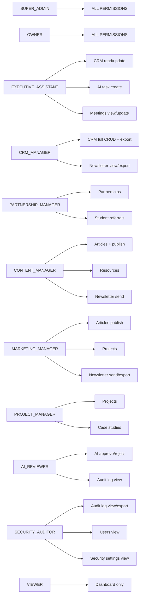

# Security Model — Alaminn.info V5

This document describes the security architecture of Alaminn.info: how
sessions are signed and verified, the role-based access control matrix, how
the Command Center is hidden from the public, rate limits, security headers,
and the audit log.

The guiding principle: **client state is never trusted**. Every privileged
API route re-validates the signed session cookie against the database before
performing any action. Frontend role state is informational only.

---

## 1. Authentication — HMAC-Signed Session Cookies

Implementation: `src/lib/auth.ts`.

The app does **not** use NextAuth. Authentication is a custom, minimal,
server-side implementation built on HMAC-signed cookies.

### 1.1 Session format

The session cookie (`alaminn_session`) carries a single string of the form:

```
<userId>.<role>.<expiresAtEpochSec>.<hmac-sha256-hex>
```

Where:

- `userId` — the User row's `id` (cuid).
- `role` — one of the 11 `UserRole` values (see §2).
- `expiresAtEpochSec` — Unix epoch seconds, 8 hours from issue time.
- `<hmac-sha256-hex>` — HMAC-SHA256 of `<userId>.<role>.<expiresAtEpochSec>`
  using `AUTH_SECRET` as the key, hex-encoded.

### 1.2 Signing & verification

```ts
function sign(payload: string): string {
  const sig = createHmac("sha256", getAuthSecret()).update(payload).digest("hex");
  return `${payload}.${sig}`;
}

function verify(token: string): string | null {
  // Split payload + signature, recompute the HMAC, compare in constant time.
  // Any mismatch (tampering with userId/role/expiry) invalidates the session.
}
```

Verification uses `timingSafeEqual` to compare the signature bytes, defeating
timing-based oracle attacks.

### 1.3 Cookie attributes

The cookie is set with:

| Attribute | Value | Why |
| --- | --- | --- |
| `httpOnly` | `true` | JavaScript cannot read the cookie (defeats XSS session theft) |
| `secure` | `true` in prod, `false` in dev | Cookie only sent over HTTPS in prod |
| `sameSite` | `lax` | Cookie sent on top-level navigations; not sent on cross-site POSTs (CSRF defense) |
| `path` | `/` | Cookie sent to every route |
| `maxAge` | `28800` (8 hours) | Matches the signed expiry |

### 1.4 Session lifetime

- **TTL:** 8 hours (`SESSION_TTL_SEC = 60 * 60 * 8`).
- The expiry is part of the signed payload, so a client cannot extend it by
  editing the cookie.
- `getSession()` re-checks the user's `status` against the DB on every call.
  If the user has been suspended since the session was issued, the session is
  treated as invalid (`fail closed`).
- `getSession()` honors the user's current DB role, not the role baked into
  the cookie — so if an admin demotes a user mid-session, the new (lower)
  permissions take effect immediately.

### 1.5 Password hashing

Passwords are hashed with **scrypt** + per-user salt, not bcrypt:

```ts
const SCRYPT_PARAMS = { N: 16384, r: 8, p: 1, maxmem: 32 * 1024 * 1024 };

function hashPassword(password: string): string {
  const salt = randomBytes(16).toString("hex");
  const hash = scryptSync(password, salt, 64, SCRYPT_PARAMS).toString("hex");
  return `scrypt$${salt}$${hash}`;
}
```

Verification uses `timingSafeEqual` to compare the derived hash with the
stored hash, defeating timing attacks.

The login route always runs a `verifyPassword` against a dummy hash even when
the email doesn't exist, keeping the response time constant (defeats
user-enumeration via timing).

### 1.6 AUTH_SECRET

- HMAC key for signing session cookies.
- **Must be ≥ 32 bytes** in production. The app refuses to start otherwise.
- Generated with `openssl rand -hex 32`.
- See [environment.md §4](./environment.md#4-auth_secret).

### 1.7 Route-handler auth guard

Every privileged route uses `requirePermission()`:

```ts
const guard = await requirePermission(req, "ai_approvals.decide");
if (guard.denied) return guard.response;  // 401 or 403
// guard.session is non-null here
```

`requirePermission()`:

1. Reads the session cookie from the request.
2. Verifies the HMAC signature in constant time.
3. Re-checks the user's status against the DB.
4. Re-checks the user's current role against the DB (honoring mid-session
   role changes).
5. Calls `hasPermission(role, perm)` against the RBAC matrix (see §2).
6. Returns `{ denied: true, response }` with 401 (no session) or 403
   (insufficient permission), or `{ denied: false, session }` on success.

---

## 2. RBAC — Role-Based Access Control

Implementation: `src/lib/rbac.ts`.

### 2.1 The 11 roles

| Role | Label | Notes |
| --- | --- | --- |
| `SUPER_ADMIN` | Super Admin | All permissions (expanded at runtime) |
| `OWNER` | Owner | All permissions. Provisioned via `scripts/seed-admin.ts` only — never appears in the login form picklist. |
| `EXECUTIVE_ASSISTANT` | Executive Assistant | CRM read/update, AI task create, meetings |
| `CRM_MANAGER` | CRM Manager | Full CRM CRUD + export |
| `PARTNERSHIP_MANAGER` | Partnership Manager | Partnerships + student referrals + CRM read |
| `CONTENT_MANAGER` | Content Manager | Articles, resources, case studies, impact records, newsletter send |
| `MARKETING_MANAGER` | Marketing Manager | Content update + publish, projects, analytics, newsletter send/export |
| `PROJECT_MANAGER` | Project Manager | Projects, case studies, impact records, meetings |
| `AI_REVIEWER` | AI Reviewer | AI task review/update, approve/reject decisions, audit log view |
| `SECURITY_AUDITOR` | Security Auditor | Audit log view/export, security settings view, users view |
| `VIEWER` | Viewer | Dashboard only |

`SUPER_ADMIN` and `OWNER` receive every permission (computed at runtime as
`new Set(ALL_PERMISSIONS)`), so the matrix doesn't need to be updated when
new permissions are added.

### 2.2 Permission strings

Permissions are namespaced `<resource>.<action>`:

```
dashboard.view

contacts.{view,create,update,delete,export}
inquiries.{view,create,update,delete,export}
opportunities.{view,create,update,delete,export}
meetings.{view,update,delete}

ai_tasks.{view,create,update,delete}
ai_approvals.{view,decide}

articles.{view,create,update,publish,delete}
resources.{view,create,update,delete}
projects.{view,create,update,delete}
case_studies.{view,create,update,delete}
impact_records.{view,create,update,delete}

newsletter.{view,export,send}

partnerships.{view,update}
student_referrals.{view,update}

audit_logs.{view,export}
security_settings.{view,update}
integration_settings.{view,update}

users.{view,create,update,delete,role_assign}
```

A role either has a permission or it does not — there is no conditional
grant. Bulk actions use the same permission as their singular counterpart.

### 2.3 The matrix (subset — full matrix in `src/lib/rbac.ts`)



### 2.4 Single source of truth

`src/lib/rbac.ts` is the **only** place role logic should live. The frontend
mirrors role labels for display, but every privileged operation is enforced
server-side via `requirePermission()`. Do not duplicate role logic on the
client — it's a security risk.

---

## 3. Command Center Access

The Command Center is the staff dashboard (CRM / AI Workspace / Approvals /
Audit). It is layered on top of the public homepage route (`/`).

### 3.1 Launcher visibility

The floating launcher button (bottom-right) is **only rendered when the user
is authenticated**:

```tsx
{sessionUser && (
  <button className="fixed bottom-5 right-5 …" onClick={openCommandCenter}>
    …
  </button>
)}
```

Unauthenticated visitors never see the button, the keyboard shortcut, or the
search-palette entry.

### 3.2 How staff reach the login modal

Three discreet entry points (none advertised in the public UI):

1. **URL hash:** navigate to `/#staff`.
2. **Keyboard shortcut:** `Ctrl/Cmd+Shift+C`.
3. **(Removed from public)** The `Cmd+K` / `Ctrl+K` search palette no longer
   shows an "Open Command Center" action item to unauthenticated users.

### 3.3 Public bundle contains no CRM data

`src/app/page.tsx`'s `getPublicData()` fetches **only public content**:

```ts
db.project.findMany({ where: { visibility: "public" } });
db.caseStudy.findMany({ where: { featured: true } });
db.article.findMany({ where: { status: "published" } });
db.resource.findMany({ where: { status: "published" } });
// …
```

All CRM data (inquiries, opportunities, contacts, AI tasks, meetings, audit
logs) lives behind `/api/v1/admin/*` endpoints that require an authenticated,
RBAC-permissioned session. The public HTML/JS bundle **must not** contain any
CRM payload.

### 3.4 Login flow

1. Staff opens `/#staff` → login modal appears.
2. Staff enters email + password → `POST /api/v1/auth/login`.
3. Server verifies credentials (scrypt + timing-safe compare).
4. On success, server sets the HMAC-signed session cookie (HttpOnly,
   SameSite=Lax, Secure in prod).
5. Client polls `GET /api/v1/auth/session` to confirm the session is active.
6. On confirmation, the launcher button appears.
7. Client fetches `GET /api/v1/admin/dashboard` (requires `dashboard.view`).
8. CRM data renders in the Command Center.

### 3.5 Sign-out

`POST /api/v1/auth/logout` clears the cookie and writes an `auth.logout`
audit-log entry. The launcher button disappears on the next render.

---

## 4. Rate Limits

All rate limits are in-memory, per IP hash (sha256 of the client IP, truncated
to 16 hex chars). They reset on process restart. The IP hash is one-way — it
cannot be reversed to recover the IP.

| Endpoint | Limit | Window | Lockout |
| --- | --- | --- | --- |
| `POST /api/v1/auth/login` | 5 **failures** | 15 min | 15 min after 5 failures |
| `POST /api/v1/inquiries` | 5 requests | 1 min | — |
| `POST /api/v1/newsletter` | 5 requests | 1 min | — |
| `POST /api/v1/meetings` | 5 requests | 1 min | — |
| `POST /api/v1/analytics/track` | 30 events | 1 min | — |
| `POST /api/v1/ai/tasks` | 10 requests | 1 min | — |
| `GET /api/v1/meetings/admin` | 30 requests | 1 min | — |
| `PATCH /api/v1/meetings/admin` | 30 requests | 1 min | — |

### 4.1 Login lockout behavior

The login route is the only one that **locks out**:

- After 5 failed attempts within 15 minutes, the IP hash is locked for 15
  minutes.
- During lockout, any login attempt (even with correct credentials) returns
  429 with `errors: ["rate_limited_locked"]` and a `minsLeft` message.
- Successful logins reset the failure counter.
- After 3 failed attempts on a **known** email, a `securityAlert` email is
  sent to the account owner. Email failure does not crash the login flow.

### 4.2 Multi-host caveat

The in-memory limiter is intentional for a single-host deployment. For
multi-host, replace the `Map`-based limiters with a Redis-backed token bucket
so all hosts share the same counter. The current implementation would let an
attacker multiply their budget by the number of hosts.

---

## 5. Security Headers

Implementation: `src/proxy.ts` (Next.js 16 renamed `middleware.ts` to `proxy.ts`; the file is the same pass-through security-header injector, just renamed).

Every matched response (`/api/*` and `/`) carries these headers:

| Header | Value | Defense |
| --- | --- | --- |
| `X-Content-Type-Options` | `nosniff` | Stops browsers from MIME-sniffing a response away from its declared Content-Type (prevents XSS via file upload confusion) |
| `X-Frame-Options` | `DENY` | The site cannot be framed by anyone — defeats clickjacking |
| `Referrer-Policy` | `strict-origin-when-cross-origin` | Cross-origin referrer leaks only the origin (no path/query) |
| `Permissions-Policy` | `camera=(), microphone=(), geolocation=(), browsing-topics=(), interest-cohort=()` | Disables client-side feature APIs the app never uses; opt-outs from FLoC / Topics API |
| `Strict-Transport-Security` | `max-age=63072000; includeSubDomains; preload` | Forces HTTPS for 2 years (production only — emitting on HTTP localhost would break dev) |

The middleware is **pass-through**: it never blocks, redirects, or rewrites.
Its only effect is header injection + the request-counter increment used by
`/api/health/deep`.

### 5.1 Why no CSP?

A Content-Security-Policy header is intentionally not set in the current
build. Adding one requires auditing every inline script (JSON-LD,
`next-themes` no-flash script, `next/image`'s preload), every external
domain (Google Fonts, Resend API), and every `dangerouslySetInnerHTML`
usage. This is tracked as a follow-up hardening task; the absence of CSP is
documented in `docs/security-report.md`.

---

## 6. Audit Logging

Implementation: writes to the `AuditLog` Prisma model.

Every privileged action and every public-form submission writes an audit log
entry:

```prisma
model AuditLog {
  id         String   @id @default(cuid())
  actorId    String?  // User.id of the actor (null for anonymous/system)
  actor      User?    @relation(...)
  action     String   // e.g. "auth.login_success", "inquiry.created", "ai-task.approved"
  resource   String?  // e.g. "user", "inquiry", "ai-task"
  resourceId String?
  meta       String?  // JSON string with action-specific data
  ipHash     String?  // sha256 of client IP, truncated to 16 hex chars
  createdAt  DateTime @default(now())
}
```

### 6.1 Audited actions

| Action | When |
| --- | --- |
| `auth.login_success` | Successful login |
| `auth.login_failed` | Failed login (actor unknown — `resourceId: user?.id \|\| "unknown"`) |
| `auth.logout` | Sign-out |
| `user.provisioned` | OWNER account seeded via `scripts/seed-admin.ts` |
| `inquiry.created` | Public contact-form submission |
| `meeting_request.created` | Public meeting-request submission |
| `meeting_request.status_changed` | Admin updates a meeting's status (with `from`/`to`) |
| `newsletter.subscribed` | Newsletter subscribe |
| `newsletter.confirmed` | Newsletter email verification |
| `ai-task.created` | AI task created (with workflow, sensitivity, requester) |
| `ai-task.approved` / `rejected` / `revision` | AI approval decision (with reviewer + previous/new status) |
| `email.sent` | Every email send attempt (with template, recipient, provider, success/failure) |
| `email.retry_succeeded` / `email.retry_failed` | Background retry outcomes |
| `analytics.track_db_failed` | Analytics event DB write failed (logged via `logger.warn`, not AuditLog) |

### 6.2 What's NOT audited

- Analytics event ingestion (high-volume; lives in `AnalyticsEvent` table
  instead).
- Public content reads (articles, projects).
- Health checks.

### 6.3 Audit log access

The audit log is viewable from the Command Center by roles with
`audit_logs.view` (`AI_REVIEWER`, `SECURITY_AUDITOR`, `SUPER_ADMIN`,
`OWNER`). Export requires `audit_logs.export` (`SECURITY_AUDITOR`,
`SUPER_ADMIN`, `OWNER`).

The sidecar `mini-services/audit-worker` (port 3003) provides a read-only
HTTP API for audit log reports and CSV/JSON export — useful for SIEM
ingestion.

### 6.4 Tamper-evidence

The audit log is append-only by application convention — there is no
`AuditLog.update` or `AuditLog.delete` call anywhere in the codebase. A
privileged DBA could still modify rows directly in SQLite; for true
tamper-evidence, replicate the audit log to an append-only remote target
(S3 Object Lock, WORM storage, etc.) via the audit-worker's export endpoint.

---

## 7. Security Test Suite

Implementation: `scripts/security-tests.ts`. Run with `bun run security:test`
against a running dev server.

### 7.1 What it tests (22 tests)

1. **SQL Injection** — POST `' OR 1=1--` in name + email → expects 422 (no
   500).
2. **XSS (stored)** — POST `<script>alert(1)</script>` in fields → expects
   not echoed in response.
3. **CSRF (no Origin/Referer)** — POST with no Origin header → expects 200
   (SameSite=Lax handles CSRF).
4. **Path Traversal** — `GET /api/v1/public/../../../../etc/passwd` → expects
   404.
5. **IDOR** — try to fetch another user's inquiry by ID without auth →
   expects 401/404.
6. **Privilege Escalation** — `VIEWER` tries to approve an AI task → expects
   403.
7. **Cookie Tampering** — modify the session cookie's role field → expects
   401 (HMAC mismatch).
8. **Open Redirect** — `?next=https://evil.com` → expects no redirect.
9. **Login rate limit** — 5 wrong passwords → expects 429 + lockout.
10. **Login brute force** — 6th attempt during lockout → expects 429.
11. **Inquiry rate limit** — 6 inquiries in 1 min → expects 429.
12. **Newsletter rate limit** — 6 subscribes in 1 min → expects 429.
13. **Meeting rate limit** — 6 meetings in 1 min → expects 429.
14. **AI task rate limit** — 11 AI tasks in 1 min → expects 429.
15. **Malformed JSON** — POST invalid JSON → expects 400 (no 500).
16. **File upload rejection** — POST multipart with file → expects 400.
17. **Honeypot** — POST with `website` field set → expects 400 spam.
18. **Missing consent** — POST inquiry without `privacyConsent` → expects
   422.
19. **Invalid email format** — POST `jane@` → expects 422.
20. **Security headers** — `GET /` returns all 5 expected headers.
21. **Clickjacking** — `X-Frame-Options: DENY` present.
22. **HSTS (prod only)** — `Strict-Transport-Security` present in prod, absent
    in dev.

Each test returns `{ id, name, description, expected, pass, details,
severity, observed }`. Severity levels: `critical / high / medium / low /
info`.

### 7.2 Test isolation

The script:

- Creates a `security-test@example.com` test user (role `VIEWER`,
  scrypt-hashed known password) before tests; deletes it after.
- Cleans up all test inquiries/contacts/opportunities/tasks/student-referrals
  with email containing `security-test` after tests.
- Tests are ordered to minimize cross-test interference from in-memory rate
  limiters (read-only tests first, then login, then inquiry, then
  brute-force LAST because it locks the test IP for 15 minutes).

### 7.3 Output

- Stdout: a summary table with `┌─┬─┐` box-drawing characters.
- `docs/security-report.md`: the latest detailed report (committed).

---

## 8. Password & Account Policies

- **Minimum password length:** 12 characters (enforced by
  `scripts/seed-admin.ts`).
- **Maximum password length:** 1024 characters (DoS guard in
  `/api/v1/auth/login`).
- **Password storage:** scrypt (`N=16384, r=8, p=1`) + 16-byte per-user salt.
- **Password reset:** not implemented in the current build. The OWNER can
  reset a user's password from the Command Center (requires `users.update`).
- **Account suspension:** setting `User.status` to `suspended` invalidates
  the user's existing session on the next `getSession()` call (the DB lookup
  fails the `status === "active"` check).

---

## 9. IP Hashing

The raw client IP is **never** stored. Only a sha256 hash, truncated to 16
hex chars, is persisted in `AuditLog.ipHash`, `Inquiry.ipHash`,
`MeetingRequest.ipHash`, and `AnalyticsEvent.ipHash`.

```ts
function ipHash(req: NextRequest) {
  const ip =
    req.headers.get("x-forwarded-for")?.split(",")[0]?.trim() ||
    req.headers.get("x-real-ip") ||
    "unknown";
  return createHash("sha256").update(ip).digest("hex").slice(0, 16);
}
```

The hash is one-way — it cannot be reversed to recover the IP. It's used for:

- Rate-limiting (in-memory `Map` keyed by hash).
- Abuse detection in the audit log (correlating activity from the same IP
  without storing the IP itself).

The truncation to 16 hex chars (64 bits) is intentional — it provides enough
entropy to distinguish legitimate users while preventing the hash from being
used as a persistent fingerprint across services.

---

## 10. Privacy-Friendly Analytics

The analytics subsystem is designed to be **cookie-less, first-party, and
Do-Not-Track-respecting**. See [architecture.md](./architecture.md) for the
full flow.

- No cookies are set or read.
- The raw IP is never stored (only the truncated sha256 hash).
- `sessionId` is a client-generated, daily-rotating anonymous ID stored in
  `localStorage` (not a cookie).
- `navigator.doNotTrack === "1"` disables `trackEvent` entirely.
- UTM parameters are accepted from the request body and persisted for
  marketing attribution.
- The `/api/v1/analytics/track` handler never throws — every error is
  swallowed and a 204 is returned.

---

## 11. Known Limitations & Follow-ups

Documented honestly so they can be tracked:

1. **No CSP header** — adding one requires auditing every inline script and
   external domain. See §5.1.
2. **In-memory rate limits** — single-host only. See §4.2.
3. **No password reset flow** — OWNER can reset passwords from the Command
   Center; a self-service flow is a follow-up.
4. **No 2FA** — single-factor authentication only. TOTP/WebAuthn is a
   follow-up for the OWNER and SUPER_ADMIN roles.
5. **Audit log is application-append-only** — for true tamper-evidence,
   replicate to append-only remote storage. See §6.4.
6. **No CSRF token** — SameSite=Lax is the sole CSRF defense. Sufficient for
   this app's threat model (no cross-site state-changing GETs, all writes are
   POST/PATCH with `SameSite=Lax` cookies), but a double-submit token would
   be defense-in-depth.

These limitations are also documented in `docs/security-report.md` after each
test-suite run.
